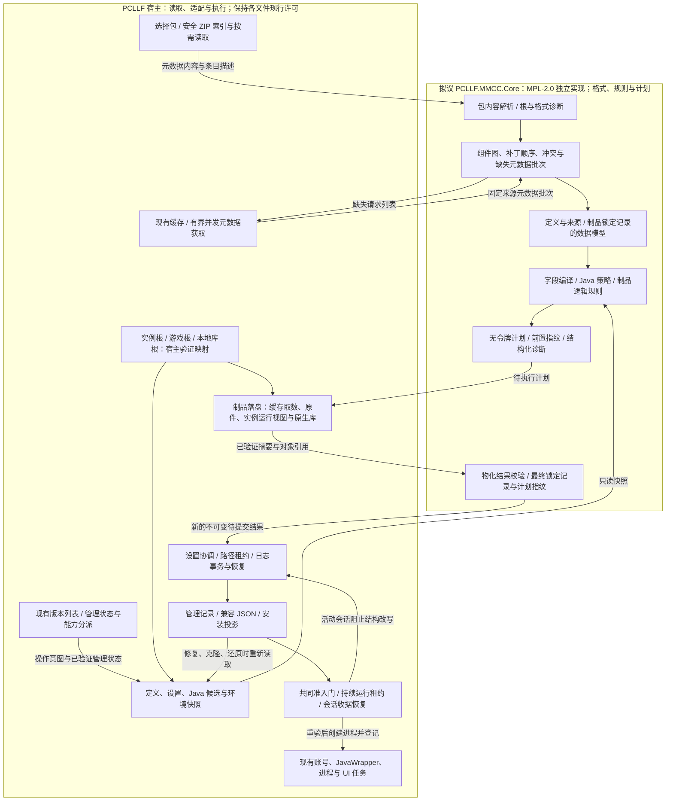
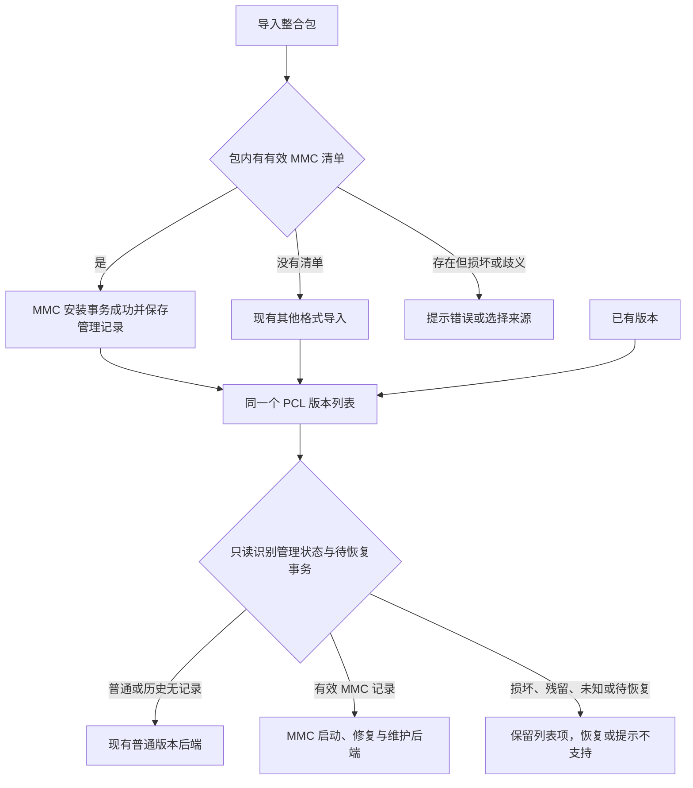
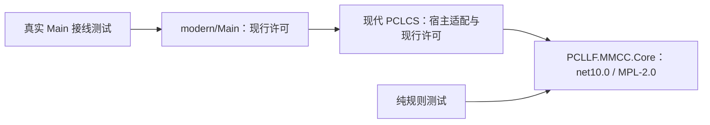
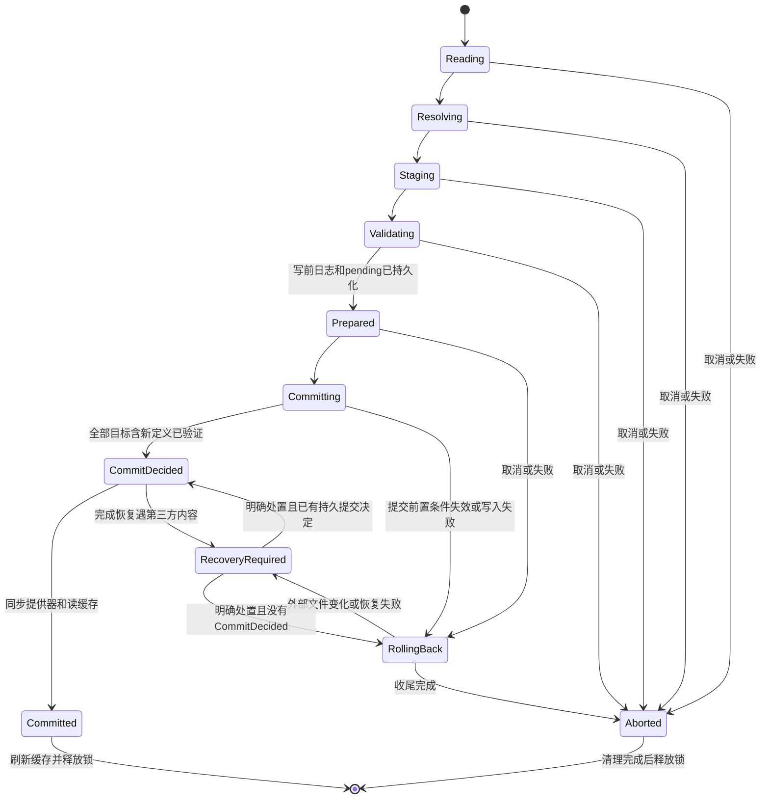
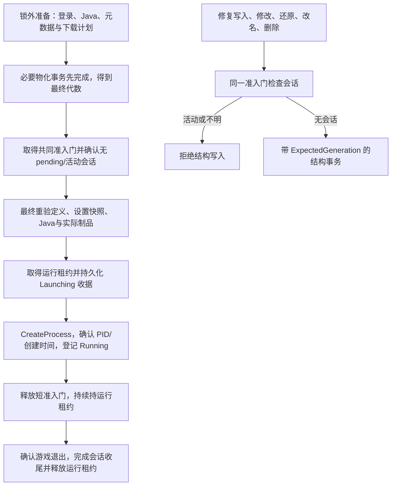
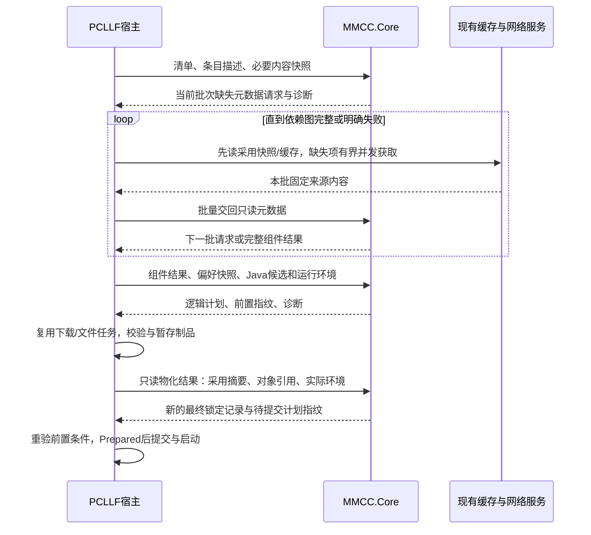
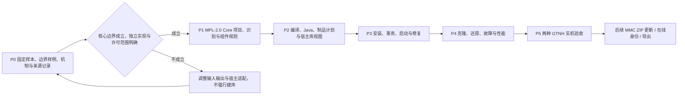

# MMC 兼容与实例模型设计

实施状态（2026-11-09）：已按完整兼容 goal 在独立 agent 子分支实施，不以 P0/P1 作为收尾。
下文“本轮”保留 R7 设计轮的历史范围，实际开发、接线和验证进度见
[全任务审计清单](mmc-completion-ledger.md)与[开发记录](mmc-development.md)；未完成的设计能力不能视为已实现。

新增产品接线包含组件／补丁编辑、平台来源核实与在线 ZIP 更新，以及隔离实例永久清理，分别有实际 Main 定向证据。
永久清理只在本地 NTFS／TxF 能力可用时执行；其他环境保留隔离与恢复。具体支持边界见
[清理记录](mmc-quarantine-purge.md)和[平台来源记录](mmc-platform-origin-backend.md)。

当前优先级（2026-11-08 用户再次确认）：先修 bug、补齐 MMC 兼容功能；性能优化放到启动器后期工程。
不以性能候选、完整压测或额外性能收益作为当前功能收口的前置条件。下文性能设计保留供后续使用。

状态：待实现的设计方案，修订 R7（2026-11-08）。R6 技术设计的 H1–H5 已经独立 Astra high 关闭复核；R7 按用户明确决定增加“Core 采用 MPL-2.0、参考机制但独立实现、宿主保留原许可”的政策与开发门槛，不将历史技术审查扩称为新代码权属/整体分发许可已审计。采用独立类库是有条件的工程选择，P0 的边界样例通过后才在 P1 落地；本轮不创建实际项目。基线为 `codex/mmc-compatibility` 的 `09ce7a5c8dde9324552daca8ba50e162cad27c98`，基线记录日期 2026-11-07。本文件中的类型、文件和能力均为拟议实现，不表示已经通过产品或 GTNH 实机验收。本轮仅交付设计、架构 map 和方案审查，不提交产品改动、不合并 main、不发布 Release。

## 1. 交付目标与边界

第一阶段同时交付通用 MMC/Prism 的组件解析、实例运行定义、导入、启动、修复、必要的克隆/还原适配，以及缓存、下载去重、真实任务进度。以 GTNH 同一官方发行版本的 Java 8 与 Java 17–26 两份客户端包为主要样本，覆盖普通 Forge/Fabric MMC 包。包名、GTNH 名称、MC 1.7.10 不能成为选择 Java 或删除 LWJGL 的特判条件。

第一阶段必须完成：导入 → 核对启动配置 → 主菜单 → 创建世界并正常退出 → 修复/缺库补全 → 再启动并重开世界。现代包逐项记录实际测试的 Java 主版本，不将一次启动等同于全部声明版本均实测。

第二阶段扩展从新版 MMC ZIP 更新，比较作者文件与组件/补丁两类变化；后续再扩展有可靠平台身份的在线更新、导出、旧实例身份迁移与更广的平台能力。首期保留现有游戏根选择与 `versions/<实例名>` 扫描位置；仅新 MMC 实例在该位置内保留独立 `minecraft/.minecraft` 游戏子目录，普通旧实例不迁移。新 MMC 活动会话要求宿主监视器后台存活，其阶段性退出能力限制见 10.1；普通实例的设置、资源、账号和退出行为保持原契约。

版本列表、收藏、分组和现有目录继续由同一套 PCL 入口提供；后台按明确管理记录分派普通版本与 MMC 操作。导入成功后保存管理记录，以后不按版本名、MC 版本号或 Forge/Fabric 类型猜测来源。没有来源记录的历史版本保持原流程；明确重新导入或经过可验证的来源转换后，才启用新 MMC 管理。

语言继续使用 C#。拟采用单个 `PCLLF.MMCC.Core`、`net10.0` 类库承载格式、语义和计划，宿主承担副作用执行。强约束是清晰的核心边界，不是把全部 MMC 功能搬进新程序集；如果首个样例仍须反向依赖 PCLCS 或庞大 host 才能工作，先修正边界，再决定是否建库。

许可决策：有权授权的新原创 Core 实现采用 **MPL-2.0**；参考上游格式、机制与行为测试，独立编写实现。PCLLF 宿主及现有文件继续各自的现行许可，根许可不因新 Core 被替换。独立目录/程序集只划清范围，不能把上游代码改标为 MPL；实施规则见14.3。

## 2. 当前实现与必要接入点

| 当前入口 | 已核实行为 | 设计要求 |
| --- | --- | --- |
| [ModpackInstallEngine](../PCLCS/Minecraft/ModpackInstallEngine.cs) / [ModpackInstallLocal](../PCLCS/Minecraft/ModpackInstallLocal.cs) | MMC 识别，读取 cfg，复制游戏文件，提取常见加载器版本，跳过 LWJGL；缺 cfg 拒绝；首行 name 不能正常作为候选 | 改为读取完整组件定义与来源，允许缺 cfg，正确处理根目录、首行及转义 |
| [安装契约](../PCLCS/Minecraft/MinecraftInstallContracts.cs) / [导入契约](../PCLCS/Minecraft/ModpackInstallContracts.cs) | 以扁平 McComponents 传递游戏/加载器目标 | 增加可选的完整 MMC 安装上下文，贯穿所有调用者，避免信息在适配层丢失 |
| [MinecraftInstallPlans](../PCLCS/Minecraft/MinecraftInstallPlans.cs) | 普通组件安装与 JObject.Merge，支持库补全，写安装清单 | 为 MMC 接入显式编译结果和安装动作；普通安装器不得重写包已经接管的启动字段 |
| [LegacyMinecraftLibraries](../PCLCS/Minecraft/LegacyMinecraftLibraries.cs) / [LegacyLaunchArguments](../PCLCS/Launch/LegacyLaunchArguments.cs) | 常规 Maven 全局库路径、版本 JAR、全局 library_directory、既有参数拆分/去重 | 接入统一的制品定位、MMC 本地库、mainJar、原生库及有序参数；防止旧去重再次改变编译结果 |
| [LegacyJavaRequirements](../PCLCS/Minecraft/LegacyJavaRequirements.cs) / [LegacyJavaSelection](../PCLCS/Minecraft/LegacyJavaSelection.cs) | 现有 Java 搜索、实例偏好、连续区间、旧 Forge 的 Java 8 上限推断 | 加入声明候选集合与有来源的约束，只对被替换的启动组件停用对应经验推断 |
| [MinecraftInstallWorkflow](../PCLCS/Minecraft/MinecraftInstallWorkflow.cs) | 现有修改流程直接删除/移动版本 JSON/JAR，再写配置 | 新 MMC 修改不能直接套用此多步写入路径，必须先接入完整事务；其他调用者范围另行评估 |
| [EnvironmentHistoryEngine](../PCLCS/Minecraft/EnvironmentHistoryEngine.cs) / [Restore](../PCLCS/Minecraft/EnvironmentHistoryEngine.Restore.cs) / [InstanceCloneEngine](../PCLCS/Minecraft/InstanceCloneEngine.cs) | 配置和依赖有固定收集/还原白名单 | 增加实例定义、源快照、用户组件覆盖及私有制品的覆盖版本；旧快照按原覆盖范围恢复 |
| [PackUpdateEngine.Package](../PCLCS/Minecraft/PackUpdateEngine.Package.cs) | 识别 CurseForge/Modrinth 作者清单 | 第二阶段新增 MMC 适配器，复用既有三方比较、预览、备份和回滚 |
| [MmcImportChecks](../tests/PCLLF.Native.Facade.Tests/MmcImportChecks.cs) | 捕获实际导入器的安装请求，未验证真实 Java、库和游戏 | 保留原边界断言，更新有意改变的旧预期，增加完整产品及实机证据 |
| [LegacyMinecraftInstances](../PCLCS/Minecraft/LegacyMinecraftInstances.cs) | 版本列表按名称/路径缓存，并可能刷新后保存安装清单 | 在有副作用的旧加载/刷新之前读取管理记录；统一入口按后端分派，损坏 MMC 记录不得落入普通修复 |

## 3. 架构 map



本图箭头表示数据交换，不是程序集引用。Core 返回缺失请求或计划，宿主执行并把结果交回；Core 不直接调用 HTTP、设置、文件事务、进程或 UI。只有宿主实例修改事务服务可发布新代数和原件对象；Core 的模型与编译器不因此获得持久写权限。

### 3.1 识别与版本管理共存 map



此图中的“有效清单”同时要求根目录唯一、JSON 可解析、格式版本可识别且组件结构有效；文件存在只是线索，完成组件能力和安装验证后才能发布管理记录。`instance.cfg`、`patches`、包名和加载器类型不能独立决定管理模式。

### 3.2 程序集依赖 map



引用单向：Core 不引用 PCLCS、Main、WPF 或宿主全局设置/日志。Main 直接消费 Core 公共类型时可显式引用，但不能以此把 UI 回调塞入 Core。首期一个 Core 程序集即可，内部用 Models、Parsing、Resolution、Planning、Diagnostics 目录；不新增 Contracts/Abstractions/Providers 等多个程序集。

图中的许可标签表示拟议源码范围，不表示仅凭程序集隔离就完成了所有许可证兼容判断。Core 源文件、宿主适配文件、上游依赖/资源分别登记来源与适用许可；打包进同一个 EXE 不抹去这些范围。

## 4. 数据所有权与唯一事实来源

| 数据 | 持久化拥有者 | 允许的写入者 | 可否重建 |
| --- | --- | --- | --- |
| 原始 mmc-pack、cfg、本地补丁、已采用远端组件 JSON | 实例内源快照 | 导入/明确更新事务 | 不能依赖联网重新获取，必须随环境保存 |
| 已采用制品摘要、来源与不可重取原件对象 | 实例持久环境记录与内容对象库 | 导入/明确更新/AdoptDeclaredVariant 事务 | 不能随运行缓存删除；local 修复的事实依据 |
| 实例 ID、源快照摘要、组件用户覆盖、当前代数 | InstanceDefinition | 实例修改事务 | 不能从 MC 版本号或生成 JSON 猜测 |
| Java/内存/窗口/用户 JVM 偏好 | 现有 Setup.ini/config.json 设置提供器 | 现有设置写入服务 | 不在新定义中复制第二份值 |
| 游戏/模组/存档/截图 | 实例游戏目录，原有功能继续管理 | 对应资源/游戏服务 | 按现有备份策略处理 |
| 最终版本 JSON、McInstallManifest 的 MMC 投影 | 编译输出/安装投影 | 实例修改事务 | 可以从定义重建，读取须匹配代数 |
| 结构化运行计划与运行库视图 | 有边界的实例缓存 | 编译/制品服务 | 可重建；不含账号令牌和完整登录命令 |
| 通用下载缓存/Java 安装/assets | 现有全局服务 | 对应缓存/Java 服务 | 按现有规则处理，不因删实例直接删除 |

MMC 文件描述的是来源格式。PCLLF 的 InstanceDefinition 为自身模型；原始 MMC 内容保留为可追溯输入，不能把运行时重写后的数据冒充原作者声明。普通实例先由 LegacyInstanceAdapter 读取现有存储，首期不批量重写旧目录或所有旧清单。

拟议最小类型：

```text
InstanceDefinition
  SchemaVersion, ManagementKind = Mmc, FormatProfile, InstanceId, ParentInstanceId?, Generation
  Origin { PackageSha256, OriginalName, PlatformProjectIdentity? }
  SourceBundle { RelativeRoot, BundleSha256, MetadataRecords[] }
  Layout { GameRootLeaf, LayoutVersion }
  ArtifactInventory[] { ArtifactKey, State, SourceReference, DeclaredDigest?, SourceObject? }
  ArtifactLocks[] { ArtifactKey, AdoptedSha256, RecoveryObject?, MaterializedPath }
  ComponentOverrides[] { Uid, Enabled?, Version?, PatchReference? }
  InstalledProjection { ProfileFingerprint, OutputJsonSha256, ManifestGeneration }

ResolvedComponent
  Uid, Version, Enabled, OrderedPosition, SourceReference, SourceSha256
  Requirements[], Conflicts[], FieldContributions[], OverrideEffects[]

ResolvedLaunchPlan
  DefinitionGeneration, ProfileFingerprint, RuntimeFingerprint, RuntimeContext
  JavaPolicy, MainArtifact, EntryPoint, OrderedJvmArguments, OrderedGameArguments
  ClasspathArtifacts[], NativeArtifacts[], DownloadOnlyArtifacts[], Agents[]
  InstallActions[], Diagnostics[], FieldProvenance[]

ArtifactReference
  ComponentUid, ArtifactRole, MavenCoordinate?, Scope, VariantTag, SourceRevision
  RelativePath, LogicalViewPath?
  DeclaredDigest?, ObservedSha256?, Size?, Sources[], Rules[], NativeClassifier?

ValidatedInstancePaths (宿主持有，Core 只接收逻辑角色/必要环境快照)
  VersionRoot, InstanceRoot, GameRoot, LocalLibraryRoot, RuntimeRoot

SessionReceipt (宿主持久化，不含账号参数)
  SchemaVersion, SessionId, LaunchNonce, InstanceId, CanonicalRoot, DefinitionGeneration
  RuntimeFingerprint, Phase, JavaImageIdentity, LauncherIdentity, GamePid?, GameStartTime?
```

外部包路径和文件名只作为数据，所有本地引用经现有路径边界服务解析。运行计划中宿主绝对路径是本次解析结果，不作为可移植定义的长期路径。

Core 拥有 InstanceDefinition、组件、制品、计划等领域类型及其序列化/纯校验，宿主拥有实际文件与提交；ValidatedInstancePaths、SessionReceipt 是宿主契约，不进入 Core 公共 API。Core API 使用自己的组件、Java 候选描述、制品和计划类型；不接受 McInstance、McComponents、McInstallManifest、NetFile、LoaderCombo 或现有巨大 host 对象。宿主把现有类型转换为只读快照，并在执行边界将计划映射回现有设施；不得同时维护两份可变组件事实。

### 4.1 设置写入协调协议（首期前置）

安装 manifest 与强制 Java 共用 [Configs](../PCLCS/Configs.cs) 和 config.json；[Shared 配置提供器](../MeloongCore/Shared/General/Config.cs) 会用对象级锁、缓存 JObject 与延迟任务保存整个文件。因此，单独写新定义并清缓存不能保证旧提供器不再写回旧 manifest。

为 MMC 实例增加按规范路径唯一的 InstanceWriteCoordinator，所有相关 JsonConfigProvider、INI 设置、自动保存、读取时 Reset、清单刷新、克隆/还原写入都必须经此入口。不能只修改新安装器。旧普通实例保留原路径；进入 MMC 模式前先注册/重绑定该路径已有的所有提供器。不能完整接管某个写入者时，该实例的新写流程不得启用。

每次实际保存（包括自动保存、读取触发的 Reset、INI 写入），均先取得同一规范路径的跨进程准入租约，重读磁盘及当前管理代数，再处理自己拥有的键。进程内 epoch 只用于本进程失效通知，不能排空其他进程的缓存，也不能作为跨进程 fence。

键分两类：普通偏好键允许在最新磁盘基线上重放自己的键级补丁，并保留未知键；结构保留键（manifest、身份、代数、管理提示、布局/隔离根、源与制品锁定关联）只能由携带 ExpectedGeneration 的实例事务更新。旧扫描/RefreshModComponents 的过期结构补丁必须丢弃或重新计算，禁止在 N+1 上原样重放 N 的整个 manifest，即使它只是一个 JSON 键。所有实际写入后更新本进程已观察的磁盘/代数状态；其他进程在下次取得租约时自行重读重基。

结构事务协议固定为：先静默化本进程旧写入者（新设置非阻塞入队，接管/取消未执行任务，等待已执行保存结束）→ 取得跨进程准入和协调租约 → 确认没有活动会话 → 读取最新磁盘与已接受偏好补丁 → 按键合成新内容 → 统一文件事务 → 提交或回滚 → 同步相关提供器/INI 缓存并更换 epoch → 释放租约后处理排队工作。静默化等待时不得持有 AdmissionGate、Worker、UI 或提供器数据锁，避免旧保存反过来等待已被本事务持有的门。事务内部使用已验证的宿主 WriteScope 批量写，不递归调用会重新申请准入的公共 Save。异步接口只有完成真实保存后才返回“已落盘”回执。普通偏好可以在游戏运行时为下次启动保存，但不能修改活动计划或结构保留键。

不强求现有文件增加持久化设置修订号。编译/启动读取协调器提供的不可变设置快照及规范化 SettingsFingerprint；进程内 epoch 用于失效通知。ProfileFingerprint 仅绑定结构定义/组件覆盖，RuntimeFingerprint 再包含设置快照、平台、Java 和路径，避免每次调整内存都重写作者定义。manifest 一致性比较只覆盖其拥有的键及代数，不以整个 config.json 摘要把无关设置变更误判为结构变化。

必测：延迟保存跨越提交、同路径多个 instance/provider、B 进程在 A 的 Finalized 后才唤醒旧任务、过期完整 manifest 键补丁、读取 JavaForced 触发 Reset、提交期间 UI 改设置、未知键保留、回滚后缓存一致以及进程重开。把这些用例作为 P3 接线前置，不能仅通过新服务自身的测试。UI 设置回调非阻塞入队；租约内只同步线程安全数据缓存，不等待 UI 同步回调。展示通知在释放租约后派发，防止 UI 等协调器、工作线程又等 UI 的死锁。

## 5. 目录与身份

以下为新 MMC 的拟议布局，`<游戏根>` 是玩家现有选择，非新增固定目录。显式区分实例根和游戏根，不能把两棵 libraries 合并：

```text
<游戏根>/
  assets/                         全局下载来源缓存，运行访问策略见第9节
  libraries/                      现有公共下载来源，先核摘要再物化实例副本
  versions/<实例名>/              VersionRoot = InstanceRoot，继续供 PCL 扫描
    <实例名>.json                 兼容投影
    <实例名>.jar                  需要兼容布局时的主 JAR 投影
    minecraft/                    GameRoot；源包选择 .minecraft 时保留该名称
      mods/ config/ saves/ ...    新 MMC 的游戏数据
      libraries/                  游戏/模组自己的文件，不自动当 launcher-local 库
    libraries/                    LocalLibraryRoot，MMC-hint: local 的实例库
    PCL/
      Setup.ini / config.json     现有设置拥有者
      InstanceDefinition.json     当前定义与代数
      MmcSource/<bundle-hash>/    原始清单、补丁和元数据快照
      MmcOverrides/               明确的本地组件补丁，不覆盖原始来源
      MmcArtifacts/sha256/<hash>   不可重取的 local/mainJar/agent 等原件对象
      MmcRuntime/<plan-hash>/     派生运行库视图与结构缓存
      MmcTransactions/<id>/       有所有权标记的事务日志与暂存记录
```

布局契约固定为 InstanceRoot = VersionRoot；LocalLibraryRoot = InstanceRoot/libraries；GameRoot = InstanceRoot/Layout.GameRootLeaf，叶名只允许已验证的 `minecraft` 或 `.minecraft`。源目录选择与固定 Prism 一致：有 minecraft 目录时优先它；仅有 .minecraft 时选 .minecraft；都没有则默认创建 minecraft。两者同时存在时保留两棵树，只将选中的一棵用作 GameRoot；不得把未选树合并进活动游戏目录。相同位置若是普通文件则拒绝目录角色冲突。

`libraries/a.jar` 与 `minecraft/libraries/a.jar` 可合法同名异内容：前者属于实例本地制品，后者属于游戏文件。Core 的路径引用始终带 InstanceRoot/GameRoot/LocalLibraryRoot 等角色，由宿主映射；`$INST_DIR` 指向 InstanceRoot，`$INST_MC_DIR`、game_directory 和进程工作目录指向 GameRoot，不能统一替换成版本根。

新 MMC 的 PathIndie/资源目录、下载目标、预启动变量、WorldBackup、EnvironmentHistory、Clone 与恢复验证全部从经过管理记录验证的路径集读取。必须适配 [InstanceCloneEngine](../PCLCS/Minecraft/InstanceCloneEngine.cs) 中“游戏根仅能等于版本目录或公共根”的旧限定及旧隔离值推导，不能只改导入复制位置或放宽成任意子目录。设置/管理记录仍在 VersionRoot/PCL；库与源快照按角色进入快照/克隆，避免漏掉 private 库或重复收集游戏库。路径适配未完成的入口继续能力阻断。

新 MMC 实例创建 GUID 身份，路径/展示名不参与身份。改名保留 ID；克隆和重新导入生成新 ID，克隆记录 ParentInstanceId。外部复制产生重复 ID 时，两份路径在身份消歧前都不允许以该 ID 写共享索引；提示按副本导入，事务分配新 ID。路径注册表仅是定位缓存，磁盘定义和规范化路径一起校验。

首期现有路径锁继续生效，并让新服务同时校验实例 ID、规范路径和代数。不能仅按 ID 解锁，也不能由于目录改名跳过旧路径锁。MMC 新实例启用独立游戏目录；首期不允许普通隔离布尔开关直接把它改成共享数据目录，该操作需要明确的迁移方案。旧普通实例继续由原隔离规则处理。

### 5.1 导入识别、管理记录与后端分派

导入时由解析器验证包中有效的 `mmc-pack.json`，允许 `instance.cfg` 缺失，并继续验证组件、补丁和制品。安装成功的同一事务发布 `PCL/InstanceDefinition.json`，其 `ManagementKind=Mmc`、实例 ID、格式/schema 和代数为正式管理记录；失败/取消不发布一份看似成功的 MMC 标记。

为防止配置目录被清理后误落入普通修复，事务同时在既有 `PCL/config.json` 的 MMC 投影和生成版本 JSON 的 `pcllfManagement` 扩展中写入最小提示：管理类型、实例 ID、定义 schema 和代数。两处均为可重建的归属提示，不是第二份组件定义；实际事实仍来自 InstanceDefinition。提示与定义不一致时不能任择一个继续写入。提示只能由 LF 的导入/转换/维护事务生成，不能信任包内同名 PCLLF 元数据并沿用其身份；原包中的冲突保留字段按入口边界规则处理。

只读管理状态按以下顺序判断，结果与后端分派不依赖文件名猜测：

| 状态 | 条件 | 处理 |
| --- | --- | --- |
| PendingTransaction | 存在本实例待恢复事务或提交决定 | 优先按第10节恢复，未完成前阻止启动和普通写入 |
| ManagedMmc | 定义、支持的 kind/schema/profile、身份、代数及投影一致 | 进入 MMC 后端；具体操作仍检查能力和当前快照 |
| ManagedMmcRepairRequired | 定义存在但损坏，或有归属提示而定义缺失，或身份/代数/投影不一致 | 保留列表项及状态，允许查看/来源恢复；结构写入与启动先停，恢复只能从已验证定义、对象或匹配原包进行 |
| ManagedUnsupported | 明确的 LF 管理记录/提示使用未知 schema/profile/kind | 提示当前版本不支持，禁止自动按普通版本降级修复 |
| Legacy | 没有任何 LF 管理记录或归属提示 | 保持现有普通版本路径；散落的 mmc-pack/cfg 仅作为用户主动转换时的线索，不自动接管历史版本 |

所有归属证据均丢失时无法可靠还原来源，不承诺凭普通 Forge JSON 自动找回 MMC 身份。重新导入/来源转换须验证原始包并生成完整定义、记录、原件和新投影；手动勾选“MMC”不能完成转换。普通导入不会因为发现某个模组名或 MC 1.7.10 就启用 MMC 后端。

2026-11-08 用户确认旧实例迁移采用主动转换边界：只在用户明确选中旧 MMC 实例并提供对应原始 MMC ZIP 后，
预览原作者声明与当前文件差异、完成备份，再建立完整的新管理定义、来源与原件。保留存档和个人配置，
来源无法验证或游戏目录角色不明确时清楚拒绝。普通 PCL 版本保持原目录、隔离与管理规则，
本次不为它们批量或自动写入新实例 ID；讨论过的普通版本可选稳定身份层不属于本次已选择的迁移路径。

实际转换先采用“创建 MMC 管理副本，保留旧源”路径，界面明确说明不进行原地接管。
旧来源记录完整时验证其与原包的一致性；最早导入器已丢弃来源记录时，严格验证模式不得按包名、
MC／Forge 版本或少量相同文件猜认。可另提供用户明确选择的新来源重绑定意图：验证所选 ZIP 的完整内容和声明，
展示旧文件、组件与新原包差异后，由固定预览确认创建副本；记录历史来源未经验证，不冒充已恢复原作者历史。
新 ZIP 是新副本的作者基线，旧当前文件只作为个人数据快照，不能据此反推作者归属。
两种意图都先完成私有备份，保留旧实例及世界／个人配置，不处理全局共享游戏树或角色歧义目录。

`InstanceManagementReader` 只做有界原始读取，不能调用会产生 Reset/自动保存的旧设置读取来“识别”；`VersionBackendRouter` 在版本扫描、摘要加载、安装请求、启动、修复、组件修改、克隆/还原、更新及后台入口统一分派。检测到 MMC 证据后，先建立协调/恢复门禁，再创建或重绑定可能延迟写入的旧提供器。旧扫描器的 manifest 刷新/Save 不得抢在此门禁之前执行。

列表继续使用现有路径、名称、收藏和分组契约；新 ID 只用于内部关联，不直接替代 PCL.ini 的名称选择和目录查找。缓存条目必须带管理状态/记录指纹和读取版本，旧缓存第一次使用前重新识别；记录新增、删除、变更或恢复后使对应分类缓存失效，不能只凭版本目录名未变就跳过。当前列表中的损坏/未知 MMC 不得因无法解析而静默消失或被自动普通修复。

管理归属与访问能力分开：ManagementState、TransactionState、SessionState 共同决定权限。正常活动会话不把有效实例判成“定义损坏”；待确认的 Launching/运行收据则阻止新启动和结构写入，保留列表与诊断入口。所有状态仍在有副作用的旧扫描/自动保存前识别。

未适配入口仍按第12节能力门禁处理。其他启动器读取兼容 JSON 的能力不等于理解 LF 管理记录或能够安全修改；外部修改通过既有 OutputDiverged/事务检测处理。若不再由 MMC 管理，必须走明确转换事务，不能只删除提示文件来触发降级。

## 6. 包读取与组件解析

1. 一次建立 ZIP 条目索引，规范化分隔符，校验路径、Windows 文件目标冲突、重复文件条目和保留元数据路径。建立含隐式父目录的目标树：两个文件映射同一目标、文件与目录占用同一节点、父文件下再出现子条目均拒绝；只有纯目录大小写别名且所有叶文件目标互不冲突时，允许归并目录节点，给出明确诊断并保留原始条目名，不用后写覆盖消除歧义。此通用规则来自 P0 两份原包存在目录别名的实证，不按包名放宽。找到唯一可识别的实例根；多候选需明确选择，不能随便取第一个。不能依赖 ZIP 存在目录条目。
2. `instance.cfg` 可缺失。使用针对 MMC/Qt INI 的解析器覆盖首行、BOM、CRLF/LF、等号、引号、反斜杠及多行转义。不能把所有 `=` 替换成 `:` 后视为已兼容；缺名称时采用现有命名校验和输入框。
3. 保留 components 列表及 disabled/dependencyOnly/important 等声明。按 UID 关联本地补丁；有有效本地补丁时不以标准元数据覆盖。其余组件按固定来源、UID、版本获取，依赖推荐版本与精确要求分开处理。
4. 现代清单采用组件序列和依赖关系；缺失依赖插入到需要者之前，同时检测循环及精确版本冲突。旧 `order` 仅在对应旧格式兼容规则中使用，不能统一对所有 JSON 文件排序。
5. 未知 UID 但拥有有效、可解释的补丁可以支持。关键语义无法解释、必需组件不可获取、依赖冲突或格式版本不支持时，生成明确诊断并停止安装；描述性未知字段可原样保存。
6. 同时限制单项和累计预算：单个组件 JSON 初始上限 16 MiB、组件 4096、依赖边 65536、递归深度 128；累计元数据与单批内容驻留初始均为 128 MiB，超出时拆批或拒绝，不以“4096个各16MiB”允许约64GiB驻留。初始 ZIP 条目/声明制品数上限各100000，实际解压总量64GiB、单制品解包4GiB；native JAR 另限10000条目和256MiB实际输出。路径在建目标树前限制长度32767、片段255、深度128；同时限制原始路径累计16Mi字符、逻辑节点路径累计32Mi字符和最多200000节点，在分配新节点前扣预算，避免零字节条目通过隐式父目录放大索引内存。预估写入与实际解压都累计计数，目标盘空间需覆盖原件/视图/事务备份的峰值。P0 对两份真实包计数并验证默认预算，调整必须先登记再回归，不按包名临时放宽。

输出必须包含每个组件的最终来源、版本、启用状态、顺序及每个关键字段的贡献来源，供预览、诊断、差分测试和修复使用。

宿主 ZIP 读取器必须在库分配完整中央目录索引之前执行有界预检：中央目录初始上限16MiB，流式核对真实条目数和名称预算，而非只相信 EOCD 声明的数量。P0 审计工具支持明确列出的单盘普通 ZIP / 固定头 ZIP64 子集；多盘、偏移修正或扩展记录等未支持结构明确拒绝，不能先创建无界 ZipInfo 列表再检查数量。

### 6.1 固定组件决策表

| 情况 | prism-v1/LF 首期决定 |
| --- | --- |
| 重复 UID | 拒绝歧义输入，并指出两个来源；这是 LF 的保守输入策略 |
| 本地补丁 | UID 必须与所关联组件相符；支持旧 fileId 别名。清单请求版本、补丁版本、cachedVersion 分别保存；EffectiveVersion 采用补丁非空版本，否则清单版本，cachedVersion 仅作提示。版本差异显示诊断，不用远端覆盖本地；最终精确依赖按 EffectiveVersion 验证 |
| 源 disabled | 保留原值。按 R2 `canBeDisabled = !important && !dependencyOnly`；important 或 dependencyOnly 为真、或 disabled 为假时 EffectiveEnabled 为真。不可禁用组件的禁用请求产生诊断，不能静默删掉 |
| requires 收集 | 先按 R2 从清单全部组件收集依赖（包括源 disabled），准确保留精确与建议来源；仅 EffectiveEnabled 组件贡献运行字段。额外执行有效运行图校验：启用组件的必需提供者也必须启用，不满足则阻断并给出明确修复选择，不后台改变玩家禁用意图；这一保护作为 LF 有意差异记录 |
| 缺失依赖顺序 | 新依赖插入最早需要者之前；已有组件保持作者清单顺序，不作统一拓扑重排。依赖循环、互斥精确版本在提交前拒绝 |
| 精确版本冲突 | 自定义/用户明确版本不自动改写。仅自动 dependencyOnly 且没有本地覆盖的依赖允许按一致的精确要求重新解析；冲突有多个精确值则拒绝 |
| 无精确版本 | 先使用有效本地补丁版本；远端解析使用明确建议与元数据推荐快照，按清单需要者顺序选首个满足全部精确要求的建议。缺少可验证建议/推荐、同优先级仍歧义或来源不可获取时拒绝猜测，要求明确版本；采用结果与索引摘要一起锁定，不在下次启动改取 latest |
| conflicts | 在有效启用组件组合上验证，保留组件/版本来源；不能通过全局删库消除冲突 |

兼容配置明确区分 R2 相同行为与 LF 的输入/诊断保护。每项差异都进入 MMC-02 的 fixture，不能只把整体标为“与 Prism 完全相同”。

## 7. 字段兼容矩阵与编译规则

采用明确的 `prism-v1` 兼容配置，参照 R2 固定代码和真实样本记录规则。HMCL/CE 是接入经验，不以它们的所有取舍替代目标语义。格式升级时新增配置和迁移，不静默改变既有定义。

| 字段/能力 | 首期处理规则与验收 |
| --- | --- |
| mainClass / mainJar | 有序启用组件中最后一个非空 mainClass、最后一个非 null mainJar 生效；空值不清除已有值。主 JAR 独立为制品，进入 classpath 时位于普通库之后 |
| minecraftArguments / +jvmArgs / +tweakers | minecraftArguments 采用最后一个非空字符串；额外 JVM 参数按组件顺序追加并保留重复 token 组。Tweaker 应用时先从已有序列移除本次出现者，再追加本次序列，与 R2 一致；最终 token 化，不再交给普通旧去重器 |
| assetIndex / 游戏版本类型 | 仅 net.minecraft 贡献游戏版本/type/assets；非空资源对象覆盖原资源对象。其他组件的相同字段保留来源但不直接覆盖，并给出诊断。资产索引保留 virtual/map_to_resources 原标志；prism-v1 按固定 R2 的 virtual 优先、否则 map_to_resources 选择布局，两者为 true 时给出优先级诊断，不额外改写游戏 resources |
| libraries / +libraries | 先按 R2 读取规则追加至统一输入；按运行环境过滤，再分普通/native 列表。标识键采用 GradleSpecifier.matchName 的 group/artifact/classifier（不含版本）；唯一匹配时只有更高版本替换且保持原槽位，等/低版本保留原项，无匹配追加。若同键有多个已有项导致 R2 匹配歧义，LF 拒绝歧义输入并说明，避免顺手换成另一套“最高版本去重”规则；扩展名/真实路径/摘要冲突另行拒绝 |
| mavenFiles | 按顺序保留，过滤平台不适用/native 项，不应用普通库的版本去重；下载但不自动加入 classpath |
| MMC-hint: local / MMC-filename / absoluteUrl | 按实例库真实文件位置和合法文件名解析；本地库不以网络同坐标文件替代 |
| natives / classifiers / rules / extract | 根据 OS、架构和 Java 运行环境筛选，解压至实例运行目录；覆盖带空格及中文路径 |
| compatibleJavaMajors | 按有效组件顺序追加，再稳定去重为有限候选集合；空/缺失不添加，非法值拒绝。`[8]` 加 `[17,21]` 得到 `[8,17,21]`，不是交集，也不是 8～21 连续区间；后续真正平台/入口硬约束过滤另列来源 |
| compatibleJavaName | 按有序有效组件采用最后一个非空推荐运行时名称，保存到 JavaPolicy.RecommendedRuntimeName；空/缺失不清除。它只影响宿主运行时目录中的匹配/下载优先级，不扩大 allowed majors；未知名称保留诊断并使用其他符合候选策略的现有查找流程，不能把名称当路径执行 |
| requires / conflicts / disabled | 纳入组件解析和最终验证，禁用不等于从源记录删除 |
| traits / agents / jarMods / 额外安装动作 | 由枚举能力表判定。初始规则：FirstThreadOnMacOS 在 Windows 记录为不适用，texturepacks/no-texturepacks 为界面提示；legacyFML、legacyLaunch、alphaLaunch、noapplet、agent、jarMods 与额外安装动作在对应执行器/fixture 成立前为已知不支持并拒绝；P0 若发现 GTNH 使用其中任何项，必须先实现该执行器才能进入该包的 P5 |

未知字段分为固定注册表中的 Supported、Descriptive、UnsupportedRequired。name/description/releaseTime/可验证 cached 提示为 Descriptive，可保留；关键启动域中未注册的字段以及未知 trait/安装动作一律归 UnsupportedRequired 并拒绝，新增支持时升级能力表/fixture。不是在运行时凭字段名称猜测“看起来关键”。R2 与 CE Java 组合的已知差异已按上表冻结，不留给实现者任意选择。

参数始终使用 token 与来源结构。建立单独的 MMC 参数消费分支，绕过旧 `SplitJavaArguments`/`DeduplicateJavaArguments` 对已解析片段的二次处理。只在明确位置绑定 LF 必要参数、登录代理、JavaWrapper；普通实例仍使用原分支。验证既比较游戏入口，也记录实际包装入口及其传递方式，不把两启动器的整条字符串机械相等当成正确性。登录信息在启动前由现有账号服务临时绑定，不进入持久化计划或证明日志。

`+jvmArgs` 数组的每个元素就是一个参数，包含空格也不再次按空格切分；cfg JvmArgs 和 minecraftArguments 则分别使用相应格式的命令字符串解析。保留空参数、引号、尾反斜杠和中文语义，宿主仅在最终进程边界进行一次平台转义，测试实际 argv。prism-v1 的 rules 采用固定 R2 的顺序匹配、默认动作与 classifier 规则，不能再调用旧 PCL Windows 正则过滤器二次改结果；R2 忽略的 os.version 在本配置中明确记录为忽略并给诊断，宿主真实平台硬约束另外校验。未知条件在能力表实现前拒绝。覆盖 windows-x86_64、Java与宿主位数不同、`${arch}`、多条规则顺序及未知条件。

### 7.1 cfg 的有效行为能力表

先计算 Override/继承后的有效行为，再判定能力；禁止把未列入 JSON 补丁能力表的 cfg 行为静默丢掉。布尔和转义值非法时拒绝，不能按 false 吞掉。OverrideCommands 采用 R2 的旧别名 OverrideLaunchCmd；同时存在时新键优先，保留冲突诊断。

| 字段/类别 | 首期规则 |
| --- | --- |
| name、iconKey、notes | 名称/图标按现有校验和文件规则迁移，notes 仅作描述；不执行内容 |
| OverrideJavaLocation/JavaPath、OverrideJavaArgs/JvmArgs | 按第11节三态和 Java 策略处理；来自别机的路径只是推荐，需宿主实际验证 |
| OverrideMemory、MinMemAlloc/MaxMemAlloc/PermGen；OverrideWindow 及窗口字段 | 映射到已支持的实例偏好，验证范围；没有等价能力的有效要求明确拒绝或提示不支持，不伪称已迁移 |
| JoinServerOnLaunch 及地址 | 有效时校验地址并映射现有启动选项；无效值不触发外部程序 |
| OverrideCommands 下的 PreLoadCommand、PreLaunchCommand、WrapperCommand、PostExitCommand | 首期任何有效非空命令都归 UnsupportedRequired，在安装/启动预览中明确拒绝；原始值保留，不执行，也不沿用旧 PreLaunchCommand 直写 VersionAdvanceRun 的旁路。Override=false 时源中不生效的值仅保留；宿主继承的实际用户命令若非空也须检查能力 |
| OverrideEnv / Env 及相应全局继承 | R2 的活动非空环境映射首期同样为 UnsupportedRequired；没有覆盖时按宿主既有基础进程环境执行，但不能把源中的活动自定义 Env 当描述字段忽略 |
| OverrideConsole、ShowConsole、AutoCloseConsole、ShowConsoleOnError | 能映射的展示偏好由宿主处理；不改变组件计划。无等价的展示选项给明确差异诊断 |

未来启用命令能力前，必须冻结各阶段（资料加载前/启动前/Java包装/进程退出后）、GameRoot 工作目录、INST_DIR/INST_MC_DIR 变量、子进程所有权、取消收尾、允许的派生输出及执行后重新验证规则。PreLaunch 可能改变制品，执行后不能继续沿用旧指纹；cfg WrapperCommand 与 ForgeWrapper/PCL JavaWrapper 是不同能力。此处首期拒绝活动扩展是阶段范围，不表示整体goal排除这些后续兼容能力。

## 8. Java、Bootstrap 与 LWJGL

Java 策略区分：组件的声明候选/必要条件、PCL 原版版本经验推断、玩家 Java 偏好、系统平台能力。JavaPolicy 必须分型为 Unspecified、DeclaredCandidates、Unsatisfiable：所有 compatibleJavaMajors 缺失/空时为 Unspecified，使用有来源的经验约束及平台/入口硬约束决定候选；存在非空声明时为 DeclaredCandidates，经必要条件过滤后为空则为 Unsatisfiable，拒绝启动，不能回退为无约束。硬约束本身矛盾也为 Unsatisfiable。策略有解但本机未安装合适 Java 是单独的 NoInstalledCandidate，进入现有下载/选择流程，不当作声明无解。

自动选择先满足编译后的策略，再按现有偏好排序。新 MMC 的自动、目录 Java、强制指定及下载后选择分支都经过同一兼容过滤；不满足时本次 MMC 启动拒绝，允许重新选择合适 Java 或显式修改组件定义，不能靠偏好直接绕过。旧普通实例的强制选择行为单独保留并测试。这里验证的是实例启动链，不恢复已移除的逐模组 Java 告警。

`OverrideEffects` 记录哪些启动组件及字段被包替换。只有被完整替代的启动链才停用对应旧经验约束；不能为所有 MMC 或所有 1.7.10 统一取消 Java 规则。推荐 Java 与允许 Java 集合分开保存，自动下载复用现有服务，下载后重新校验候选成员资格。

组件已经提供完整 Forge/自定义启动配置时，安装计划使用该配置和制品列表。若所需安装动作不能由现有执行器处理，则拒绝该能力，不再自动运行普通 Forge 安装器“补救”。RFB、ForgeWrapper、PCL JavaWrapper、Java agent 与参数顺序均纳入真实启动验收；不先添加一套通用 Bootstrap 冒充已解决兼容。

LWJGL 选择由最终启用组件、冲突关系和库合成决定。Java 8 包保留自己的库；现代包使用自己声明的 LWJGL3/原生库。禁止全局删除 LWJGL2 或修改其他实例的同名库。

### 8.1 lwjgl3ify / RFB 等重度启动链

lwjgl3ify 是模组及其启动环境改造；MMC/Prism 组件补丁用于表达该环境。兼容目标是通用字段和执行能力，不在 Core 中加入 GTNH 或 lwjgl3ify 包名分支。R5 模板提供下列机制线索，真实发行包内容和锁定来源才是验收输入：

| 链路 | Core 输出 | 宿主执行与验收 |
| --- | --- | --- |
| 自定义 MC/Forge 与最终入口 | 保留每层字段贡献，按组件顺序生成最终游戏入口及 mainJar | 在普通 Forge 安装之前分流；验证 RFB 游戏入口与 PCL JavaWrapper 实际包装入口的交接 |
| Early classpath / forgePatches | 有序普通库、local/远端来源及采用摘要 | 按包真实来源落地，验证 early 库位置，不把模板中的 local 假定为所有发行包都 local |
| JVM 与系统类加载器 | 完整 token 组、来源和顺序，保留 add-opens、native-access、java.system.class.loader 等声明 | 一次绑定运行路径与账号必要参数，避免旧清理器改写；用实际进程验证类加载链 |
| Java 集合与推荐运行时 | 独立的 AllowedMajors、RecommendedRuntimeName 与有来源约束 | 对所有选择/下载分支统一过滤；模板中 `[17,21,25,26]` 不被扩大成 17～26，实际包另行读取 |
| LWJGL/native/traits | 有效组件冲突、平台规则和每项能力诊断 | 不混装 LWJGL2/3；FirstThreadOnMacOS 在 Windows 明确不适用，其余平台另行验收 |
| 修复/再次启动 | 从同一锁定来源和制品记录重新生成计划 | 清理派生缓存、缺库补全后入口/参数/库顺序一致，不回退普通 Forge 配置 |

R5 的模板有构建占位符，不能将 `${jvmArgs}` 等未展开文本当成已发布合法 JSON，更不能在启动器执行模板表达式。不同 lwjgl3ify 版本的参数以各发行包为准，不能硬套最新 README。官方提到的实验 Relauncher 是另一种启动模式；未验证子进程归属、退出/备份与再次启动前，不计入首期直接 MMC 启动链的已支持范围，也不凭模组文件名自动判断支持。

## 9. 制品路径、共享缓存与运行视图

制品定位拆分为 Core 的 ArtifactRuleResolver（Maven/逻辑相对位置、冲突、顺序与计划）和宿主 MmcArtifactMaterializer（真实路径授权、下载、文件校验/复制、原件与运行视图落盘）；文中统称制品服务时也遵守此边界。`Scope` 至少区分 Shared、InstanceLocal、Derived，其中 Shared 表示来源/去重范围，不授权进程直接访问可变全局路径。判断内容一致不能仅依赖 Maven 坐标或文件名：有声明摘要时按摘要验证；无声明摘要时仅在初次导入或明确 AdoptDeclaredVariant 事务计算 AdoptedSha256 并持久化至 ArtifactLocks，不能把计算本地摘要称为发布者认证，也不能在缓存删除后重新扫描并接受未知字节。

所有无可验证远端重取来源的 local/mainJar/agent/自定义制品，导入时将原件保存到 `PCL/MmcArtifacts/sha256/<hash>`，记录原 ZIP 摘要/条目路径和对象引用。保留范围独立于本次启用/运行环境：包内实例库树及所有可识别的不可重取输入，包括禁用组件引用的输入，都需入库存证；游戏/模组普通数据按 GameRoot 原规则安装，不把全部模组再复制一遍当运行制品。对象库是持久环境，不属于 Derived；运行库是其独立复制投影，不能用硬链接使玩家修改投影同时改变原件。源快照、锁定记录和对象引用在同一事务中发布，不要求保留整个 GTNH ZIP。

修复顺序固定为：校验持久原件对象 → 校验已锁定缓存/精确来源下载 → 请求重新提供摘要匹配的原包或进入明确来源更新。任何候选都必须等于 AdoptedSha256/声明摘要；缺原件且无来源时报告不可修复，不接受现存未知内容。克隆/还原必须携带锁定记录及其对象。首期对象库不自动回收；后续 GC 必须计算当前定义、快照、活动会话、准备事务的全部引用。

### 9.1 条件制品与首次采用

ArtifactInventory 覆盖保留组件的全部已知声明及来源；锁定键 `ArtifactKey` 含组件 UID、制品角色、Scope、逻辑路径/坐标、OS/架构/native classifier 等 VariantTag 和 SourceRevision，不能只按文件名或坐标识别。持久采用状态只有 Unadopted、Adopted；已采用后的 Healthy/Missing/Damaged 是独立 IntegrityObservation，不因检测损坏改写定义或预期摘要。本地源对象摘要可已知而尚未绑定某个活动变体；远端未用变体可只保存声明摘要/精确来源快照，不要求首次导入下载所有平台的库。

启用禁用组件、首次采用新 native/Java 环境变体时，生成明确的 AdoptDeclaredVariant 计划：验证既有来源/本地原件或精确远端声明 → 首次物化 → 回传摘要 → 发布追加锁定记录的新代数。它可作为启动准备中的独立可见文件任务，但必须在取得运行租约前完成，并重新生成最终启动计划。它不是 RepairExisting，不能用“修复”替换已有 AdoptedSha256。已采用内容若真的改变，应走有新 SourceRevision 的定义修改；旧锁保留为历史依据。无法恢复的未采用本地输入需匹配原包，不能临时接受当前目录中的未知字节。首期不支持的变体切换明确能力阻断。

共享缓存只作为下载与复用来源，**所有 MMC 已采用的可变共享启动制品都要在启动前复制到实例 owned、按摘要锁定的运行视图**，包括普通 classpath、mainJar、agent、Wrapper 支持文件、mavenFiles 和 native 提取输入；实际进程引用全部绑定这些副本，不能直接引用全局 Maven 路径。普通实例可继续其原补库写入流程；无须要求它取得某个 MMC 实例门，也不能靠这一不成立的假设保护 MMC。不同摘要不覆盖同一活动视图，普通复制不使用硬链接或目录链接。

`local` 库继续保留 InstanceRoot/libraries 的真实平面布局和显式文件名，由本实例运行租约保护；GameRoot/libraries 仍是另一目录角色。共享来源在复制时可被其他写者改变，所以物化后必须验证副本等于已锁定摘要，不符则重试来源/拒绝，不能原地更新 AdoptedSha256。运行前以及热缓存命中时核验的是实际 owned 副本；活动期间禁止重建/覆盖/清理该视图。规则、classpath、下载、修复和会话 pin 使用同一份 ArtifactReference。

对所有 MMC 启动构建 `MmcRuntime/<view-key>/libraries` 运行视图，不仅限于某种 Wrapper。需要 Maven 路径的项按 Maven 布局落地，local 项需要兼容视图时保留相应布局；InstanceLocal 的 classpath/mainJar 默认仍指向受本实例租约保护的原本地位置。`${library_directory}` 及 Wrapper 专用参数不能偷偷返回全局库目录。Wrapper 可变生成输出放独立 owned 目录，不写已校验输入视图；实际输出路径及其再次被读取的方式纳入计划和会话验收。最终路径碰撞且内容不同时拒绝，不能任意选一份。

ViewKey 只由已采用制品身份/摘要/变体、编译器/布局版本及逻辑运行上下文构成，不包含它自己或尚未生成的视图绝对路径，避免路径与指纹循环定义；先算键，再将逻辑路径映射为实际路径并绑定最终计划。目标根/Java/偏好等 RuntimeFingerprint 输入仍明确记录。不能为修复原有 view 而覆写正在使用的同键目录。

MMC 的 library_directory、classpath、mainJar 和 Wrapper 专用路径由运行计划绑定；普通实例继续走原全局路径。assets 的下载/去重来源可共享，但源缓存不等于活动环境：首期将该计划的 asset index 和所需 objects/legacy virtual 输出物化到实例 owned assets 视图，并让 assets_root 等实际参数指向它，不复制全局所有版本资源。将来只有证明所有相关全局写者遵守内容不可变/pin 协议后，才优化为安全的共享对象访问。原生库解压路径至少按实例、计划和运行环境区分，活动输入视图与 native 目录不清理、不覆盖。该复制/磁盘成本纳入P0/P4，不能以减少成本为由跳回可变全局路径。

Java 安装不是普通 Maven 制品。宿主 Java 服务为活动会话登记所用安装身份，LF 管理的升级采用新版本目录，清理/替换不得处置活动安装；无法提供该约束的可变安装路径不能被视为已保护输入。外部软件维护 Java 仍属第10节的非合作写入边界，不能承诺拦截。删除实例不能递归删除共享缓存或 Java。

Java 安装 pin 在最终 Java 身份核验前，与 LF 安装/清理操作通过安装路径对应的跨进程 JavaServiceGate 原子协调取得，覆盖 Launching、Running 和退出收尾；异常后的待确认收据同样保留 pin，不能等 CreateProcess 后才登记。锁顺序为实例 AdmissionGate → JavaServiceGate → 后续短锁；Java 服务持门时不反向等待实例准入、Worker 或 UI。未验证此协议不开放对应 MMC 启动/清理能力。

## 10. 事务、代数与中断恢复

多文件提交不是天然原子操作。定义、源快照、生成 JSON、安装投影和必要配置以同一事务处理；现有实际文件任务、路径锁、取消等待、事务回滚可复用，新增所需日志与代数校验。MMC 不允许直接走当前 `McInstallCommit` 的无统一日志删除/覆盖路径。



1. 读取阶段捕获 DefinitionGeneration、SettingsFingerprint 和源摘要；耗时下载可在锁外进行。先按4.1在不持租约时静默化旧提供器；结构发布与启动共用路径/身份跨进程准入门，发布还需确认没有活动或待确认会话，再取得现有实例 Worker 预约及设置协调权并重读磁盘。现有进程内路径字典不能冒充跨进程或外部编辑器互斥。MMC 入口必须在旧 Worker 预约前分派并遵守10.1锁顺序；新实例暂存和保留名未完成前不发布到正常列表。
2. 所有 live 修改之前，持久化带版本/摘要的 Prepared 日志及 pending 标记。日志列出目标相对路径、旧/新摘要、旧/新内容引用、目标缺失状态和所有权。新内容与不可重取原件必须先落地并验证；磁盘不足、未知日志版本、日志损坏均保持 pending 并拒绝盲修。
3. 在同卷用可恢复替换原语逐文件落地，**包括代数 N+1 的 InstanceDefinition**。既存目标使用带独立备份路径的 File.Replace 以保存被替换时的实际旧文件；新建目标用不覆盖既存文件的 CreateNew/无覆盖移动。换入前再次检查，换出备份摘要也要与 Prepared 预期旧值核对；发现变化立即进入 RecoveryRequired。首期删除只移到事务备份，不直接不可逆删除。
4. 全部目标（定义、配置键级补丁、版本 JSON、投影）与摘要均验证/刷新后，才持久化唯一的 **CommitDecided**。这是提交决定；不存在“complete 后再写新定义”的第二提交点。此后幂等完成提供器/INI 缓存和索引同步，再写 Finalized、解除 pending、报告成功。
5. Prepared 后且无 CommitDecided 的中断按下表回滚；已有 CommitDecided 的中断按下表完成。恢复前先校验事务所有权、日志内容、路径和两侧快照，不能按某一个 JSON 的代数自行猜决定。恢复冲突保留两侧内容及日志；活动 I/O 终止后可以释放 OS/worker 租约，但持久 pending 门禁持续阻止启动/写操作，不能无限挂住线程。
6. CommitDecided 前的取消必须完成清理/回滚才返回；之后只能完成已决定事务，不能把有效提交伪报为取消。所有 LF 版本扫描、启动、修复、设置保存、组件修改、克隆和还原都先经过同一管理状态及 pending/代数门禁。定义和两处归属提示纳入同一事务和恢复表，不可先写“成功标记”再安装。

| 决定/当前目标 | 恢复行为 |
| --- | --- |
| 无有效 Prepared | 不执行任何 live 恢复写入；若存在身份不明 pending，保留并要求诊断 |
| Prepared、无决定，目标为预期新内容 | 从已验证旧备份恢复；旧值为不存在时只删除仍由本事务创建且摘要匹配的目标 |
| Prepared、无决定，目标已经为旧内容 | 保持原样，幂等继续；目标丢失则仅按日志中明确的缺失/移入备份状态恢复 |
| CommitDecided，目标为新内容 | 幂等完成缓存/索引与 Finalized |
| CommitDecided，目标为已知旧内容或事务记录的缺失 | 新副本和日志均完好时完成前滚，并采用同样可恢复替换检查；否则 RecoveryRequired |
| 任意阶段目标/备份是第三方内容 | 保留当前文件、实际换出备份和本事务副本；RecoveryRequired，不自动覆盖 |

外部并发保证明确限定：协调租约覆盖 LF 的合作写入者；不承诺阻止任意外部进程在 hash 检查与替换之间写入。带备份的替换用于保留竞态中被换出的实际内容并检测冲突，不等同于 compare-and-swap，也不保证外部读者看不到短暂中间状态。若外部进程持有不兼容句柄，失败保留现场。P3 必须在真实 Windows 验证备份替换、share mode、拒绝访问和每个崩溃点；进程中断恢复与断电/文件系统损坏的保证分别报告。写日志使用明确 flush-to-disk 原语；单独 Flush 不被宣称为跨文件持久事务。API 边界参见 R7。

### 10.1 启动、结构修改与持续会话租约

“检查过没有 pending”不等于锁住了后续使用窗口。MMC 使用路径/身份绑定的跨进程 AdmissionGate，并区分 PreferenceWrite、StructuralWrite、Launch、SessionCleanup 角色：普通偏好写可为下次启动保存；结构写必须确认没有活动/待确认会话；Launch 在最终使用计划之前取得共同准入权。现有普通实例仍走原流程。

短锁顺序固定为：只读识别及无锁静默化 → 按规范路径排序的 AdmissionGate（改名同时覆盖新旧路径）→ 涉及 Java 时的 JavaServiceGate → 相应 Worker 预约或非阻塞运行状态检查 → 本进程设置协调与 store/file 锁。MMC 适配器不得先持旧 Worker 再等待 AdmissionGate，设置保存也不能逆序等 Worker；拿不到所需能力时非阻塞返回忙碌/入队。持续 RunningLease 是会话状态租约，不要求持有整个准入门；退出收尾可以在保留自己的运行租约时重新取短准入门，但写入者绝不能持准入门等待游戏退出/运行租约释放。UI 不同步等待这些租约；租约内不同步等待 UI。只读准备/网络不长期占用准入门。



登录/元数据等待期间允许其他合法结构事务完成，但本次启动之后必须重新解析其新代数；不能拿等待前的 N 参数访问 N+1 字节。所有必要的首次物化/修复写入先作为独立结构事务完成，再重新取得最终启动准入；不能持运行租约后递归请求自己的结构写租约。最终快照验证、实际 local/mainJar/视图制品核验、CreateProcess 与 Running 登记之间连续持有 AdmissionGate，不能中途释放再检查。

首期每个 MMC 实例仅允许一个活动游戏会话。运行租约由宿主会话监视器持有直到对应 Java 进程及必要退出收尾结束，固定所用定义、local/mainJar/运行视图路径；活动期间修复写入、组件修改、还原、改名、删除均拒绝，不能仅保护 native 目录。跨实例保护采用第9节的执行副本隔离：其他普通实例即使改写同坐标全局来源，也不能影响 MMC 已验证的 owned 运行副本；不把实例路径租约错误扩大为全局文件保护。

为使租约生命周期可执行，首期 ManagedMmc 的会话监视器随宿主保持后台存活：窗口可以隐藏或关闭到后台；活动 MMC 会话期间不支持真正结束监视器的退出能力。必须在相应选项/操作中明确说明这一限制，不偷偷修改全局退出偏好，也不影响普通实例。只有验证可安全移交给独立守护者后才开放“活动 MMC 游戏仍运行时完全结束宿主”；这不是要求 Core 新开进程或新增一套 Java 启动框架。其后台资源成本纳入性能测量。

宿主在 CreateProcess 之前持久化 Launching 收据，包含非敏感启动 nonce、身份/根/代数、计划摘要、宿主与选定 Java 身份；向新 Java 进程注入专用 LF 会话 nonce（受保护的内部参数，不能由包覆盖）。创建后验证 PID+进程创建时间+Java 身份并登记 Running，完成后才释放短准入门。正常退出持久化 Exited，再释放运行租约；清理后台备份时按独立 owned store 预约，不反向获取结构锁造成自锁。

若宿主被强制结束、在 CreateProcess 与 PID 登记之间崩溃或运行租约异常丢失，持久收据仍让其他合作写入者将会话视为待确认，不因 OS 锁已释放就假定游戏已退出。恢复仅凭 PID 不够，必须核对创建时间、Java 身份和会话 nonce；必要时由宿主受控检查本用户进程，命令内容仅内存匹配、不落日志。能证明对应进程退出/未产生后才关闭收据；无权限、身份不符或无法证明则保持只读待确认，禁止自动删收据、杀其他进程或结构写入。不同启动模式产生子进程的情况需另有能力验证；实验 Relauncher 仍不计入首期直接进程支持范围。

P3 必测：A 在登录等待期间 B 提交新代数、最终检查与 CreateProcess 交错、两个启动者争用、活动游戏延迟读取 JAR 时尝试修复、每个收据崩溃点、宿主关闭窗口/真正退出请求/强制终止、PID 重用、无法检查进程、退出收尾与新任务交错。热计划命中仍须执行相同准入和字节核验。若监视器保活及恢复协议未通过，不能开放 MMC 启动能力。

## 11. 设置继承与外部改动

按 Java 位置、JVM 参数、内存、窗口等类别，在**现有设置存储**新增 MMC 专用模式键：InheritGlobal、UsePackage、Override；具体值仍只有原设置字段一份。Override 的空字符串/空列表是明确空覆盖，不退回全局。UsePackage 读取已保存 cfg 的对应 Override 标志与值；没有有效包覆盖则回退全局。初次导入：包对应 Override=true 取 UsePackage，否则 InheritGlobal，不能把当时全局值拼进实例字符串。模式设置同样经过 4.1 协调器。

计算顺序为：用户明确 Override（包括空值）→ 明确 UsePackage 的有效 cfg 覆盖 → 当前全局默认；组件必要参数独立经编译器加入，不被普通用户偏好清空。全局变化只影响继承项。导入的 JavaPath 先作为来源推荐，必须通过现有 Java 发现/身份校验及 MMC 兼容过滤，不能直接执行另一台电脑的绝对路径。需要保留的 JVM 参数区分“包必要启动参数”与“cfg 可选偏好”。

现有个人习惯同步仍通过用户选择的规则写入相应实例，不把 options.txt 变成多个实例共用的物理文件。账号、登录令牌仍由现有全局账号服务和 LF 隔离命名空间管理，不随实例定义、克隆或导出复制。

生成的版本 JSON 若被外部改动，比较已记录的 OutputJsonSha256 后进入 OutputDiverged。首期提供查看差异、保留副本以及明确从定义重建的处理，不静默覆盖，也不把任意最终 JSON 自动当成新原作者补丁。MmcOverrides 的明确修改通过重新解析、预览和事务接纳；MmcSource 内容地址目录被修改则按损坏处理。

## 12. 修复、克隆、还原与后续更新

| 操作 | 身份/定义 | 文件与缓存规则 |
| --- | --- | --- |
| 导入 | 新 ID、初始代数、原始包及已采用元数据快照 | 完整验证后发布；源来源独立保存 |
| 修复 | 保留 ID 和有效来源，必要时产生新投影代数 | 补缺失/损坏制品，固定旧来源，不顺手拉最新元数据；本地库不能用远端同坐标替代 |
| 改名 | 保留 ID；重建名称相关兼容投影 | 无运行游戏、受控锁与事务；绝对路径计划失效 |
| 克隆 | 新 ID、ParentInstanceId 指向来源 | 源定义、源快照、私有库及用户覆盖完整携带；游戏数据按原选项；派生缓存重建 |
| 环境还原 | 保留当前实例 ID，发布新的单调代数并记录恢复来源 | 恢复定义和私有环境，保留当前世界进度；损坏/旧覆盖版本不冒充完整恢复 |
| MMC ZIP 更新 | 保留 ID，创建候选来源和新代数 | 第二阶段同时比较作者文件、组件和用户覆盖；预览后复用文件事务提交 |
| 删除 | 删除实例私有内容并释放引用 | 不删除共享缓存、Java 或其他实例路径；有运行进程时按现有互斥规则处理 |

**入口门禁从 P1/P3 开始生效，不能等到 P4。** 新 MMC 一经识别，尚未适配的旧克隆、还原、普通组件修改、旧更新和隔离切换入口即通过统一能力检查阻断，并给出原因；相应集成测试通过后才解除。阻断必须覆盖 UI、后台自动任务和公开调用入口，不只是隐藏按钮。

新增 EnvironmentHistory CoverageVersion，明确列入定义、源快照、组件用户覆盖、私有库及视图所需不可再获取输入；派生计划和可重建视图不必备份。Restore 白名单同步扩展。对共享来源按内容引用恢复到本实例输入/视图，不用旧内容覆盖全局 Maven 文件。未选中的另一游戏树以独立目录角色保留，不作为活动 GameRoot 参与启动；快照不删除或改写其未知玩家数据，克隆时存档/截图选项按目录角色处理，两树不能被合并或静默丢弃。

旧还原点没有新定义/制品原件覆盖时，对当前 MMC **拒绝原样恢复其版本 JSON/config/Setup**，允许查看或导出；后续若支持配置导入，则通过明确差异预览和重新编译的事务完成。不能“提示边界后照常部分还原”。原普通实例仍按原覆盖版本恢复。Clone 除组件定义和对象外，完整复制 MMC 的 Java/JVM/内存/窗口偏好模式和对应值（含空覆盖），不沿用当前只保留 manifest 的 config 白名单；路径重写、ID 分配和缓存失效同步适配。首期跨卷移动不新增产品入口，外部移动通过重新定位和相对来源路径恢复，活动旧路径仍受锁保护。

首期另外记录作者文件的原始路径/摘要/目录角色基线（可直接纳入现有 ModpackOrigin 的版本化适配），在玩家首次运行前固定，不能等第二阶段从当前文件倒推作者内容。无需首期实现更新 UI；无法完整记录基线时，明确后续更新需要摘要匹配的旧原包。历史三方比较契约继续遵循 [整合包归属说明](modpack-update-ownership.md)。

MMC 的失败清理由事务身份/所有权标记、规范暂存路径、预期状态与代数共同授权，等待真实 I/O 和回滚结束后才能清理；不复用旧 `McInstallFailedClearFolder` 的“一秒后按旧路径删目录”判断，不能清理 live/pending 或被重试重新使用的目录。组件修改重建请求时必须完整保留 MMC 上下文；ManagedMmc 请求缺上下文直接拒绝，不能因默认 null 误走普通安装。

MMC UID 是组件身份；CurseForge/Modrinth 项目 ID 是发布来源身份，二者不互换。没有可靠平台来源时仍可从本地 MMC ZIP 更新，不能按模组名或包名猜在线项目。

## 13. 性能与任务体验

正确性约束与优化一起实现，禁止把未测的比例写成收益。

| 优化 | 缓存键/工作方式 | 失效与正确性检查 | 测量 |
| --- | --- | --- | --- |
| ZIP 索引 | 单个包摘要和条目索引 | 包摘要变化重读；不依赖目录条目 | 索引次数、元数据读取量 |
| 元数据缓存 | 来源 + UID + 精确版本 + 内容摘要 | 清单记录已采用内容；更新操作才接纳新内容 | 请求次数、冷/热解析时间 |
| 批量取数 | Core 返回当前缺失请求集合，宿主按现有并发限制合并/获取 | 按来源标识 + UID + 精确版本 + 请求种类去重；已锁定内容另核对摘要，不同 UID 不因同版号合并；每批回传后继续依赖解析 | 批次数、并发等待时间、重复请求 |
| 编译缓存 | 全部有效来源/覆盖摘要 + 编译器版本 + 格式配置 | 依赖下游一并失效，不仅看文件名/大小/mtime | 冷/热编译时间 |
| 运行计划缓存 | 编译摘要 + 设置修订 + OS/架构 + 选定 Java 身份 + 路径上下文 | 改名、移动、Java/设置变化重建；不缓存授权参数 | 启动准备时间 |
| 制品去重 | 持久 ArtifactLocks 与明确制品内容摘要 | 同坐标异内容分开；未知摘要仅在初次采用事务绑定；原件不随 Derived 清理 | 重复下载、写入字节、原件对象保留量 |
| 减少重复复制 | 受控暂存直接组织最终布局，按摘要复用本实例 owned 视图 | 必需的执行隔离副本不省略；不使用硬链接暴露全局写；原件/提交/热视图核验保留 | 解压/复制字节、assets视图与峰值磁盘 |
| 后台任务 | 复用现有 Loader/Worker/Download | 真实字节、阶段和状态；取消等待收尾 | UI 响应、取消耗时 |
| 总预算与会话成本 | 累计元数据/制品/解压预算、运行监视器保活 | 不以单项上限替代总内存/磁盘边界；异常取消后保留正确的会话门禁 | 峰值内存/磁盘、后台 CPU、关闭窗口后资源 |

任务阶段使用原生卡片：读取整合包 → 解析组件 → 获取元数据 → 准备运行库 → 安装文件 → 验证配置 → 提交。错误包含组件 UID/版本、补丁、制品和当前阶段。完成、重试与取消状态不得因同名任务覆盖而丢失；直接复用既有多阶段任务基础设施。

P0 在同机、同盘、固定包/Java/缓存状态记录至少三轮冷/热指标并采用中位数，记录未命中请求、下载/复制字节及峰值磁盘。旧实现无法完成 GTNH 链路时只记录可比较阶段及失败，不能把快速失败耗时当成完整成功基线；新链路的完整未优化基线在 P3 首次成功后冻结。P4 的预设回归门槛：热解析不联网、不重新解压整包；同一可信制品不重复下载；与对应冻结成功基线相比启动准备中位数恶化超过 10% 且绝对增加超过 200ms，或导入中位数恶化超过 15%，必须分析并关闭回归或记录明确接受的正确性成本后才能过门。视图复制、原件保留和事务双份内容计入磁盘峰值，不承诺总磁盘必然下降。门槛在测量前登记，不能看完数据后放宽以宣称达标。

### 13.1 同进程批量解析与缓存路径



Core 与宿主是同进程类库调用，不经 IPC，不为每个字段做 JSON 序列化往返。只传清单/组件、条目描述和计划，不复制整个 GTNH ZIP 或所有模组字节到 DTO。归属明确的只读数据可批量复用；流的读取、大小预算与生命周期由宿主约束，Core 不保留调用结束后失效的 ZipArchiveEntry/Stream。

未变的源快照/组件摘要可命中编译缓存；偏好、Java、路径和平台变化只重建相应运行计划。实际安装、修复、提交的必要完整性与外部变更检查仍由宿主执行，不能以“缓存命中”跳过这些前置条件。分别统计 Core 解析/编译、跨边界转换、网络等待、解压/复制/哈希和 UI 阶段，定位真实成本；独立程序集本身不作为性能提升或零开销的证明。

初次采用时，宿主将已验证制品摘要/对象引用作为只读物化结果回传，Core 校验并形成新的待提交最终锁定记录和相应计划指纹；不在原地修改共享 DTO。Prepared 固定该结果，后续不得以不同内容替换而沿用原指纹。未取得字节前的逻辑计划不是已锁定字节的提交证明；采用来源、声明摘要与实际摘要不符时停在验证阶段。

## 14. 代码落点与依赖规则

### 14.1 有条件采用一个小 Core

拟议新增根目录 `PCLLF.MMCC.Core` 和同名 `.csproj`/程序集/根命名空间，使用 `net10.0`、不启用 WPF，首期不 multi-target。它是 MMC 格式、语义与计划核心。P0 先用少量固定 fixture 验证四点：Core 无宿主引用；输入输出保留完整语义/来源/顺序；设置/凭据/路径归属清楚；计划到执行/事务的交接可行。满足后 P1 建项目和首个生产切片，不先建空壳通用框架，也不等整条复杂安装链写完再拆。

| 所在层 | 拟议职责/类型 | 不应带入的能力 |
| --- | --- | --- |
| Core / Models | 实例定义、组件图、制品引用、Java 策略、计划与诊断 DTO、格式序列化/校验 | McInstance、McComponents、McInstallManifest、NetFile、LoaderCombo、宿主配置对象 |
| Core / Parsing、Resolution | MmcManifestReader、MmcComponentResolver、归属记录内容校验 | 任意本机目录访问、HTTP、弹窗、静态设置 |
| Core / Planning、Diagnostics | MmcProfileCompiler、ArtifactRuleResolver、Java 候选过滤、指纹和结构化缺失/冲突 | 下载线程、JVM 探测进程、文件权限授权、落盘事务 |
| PCLCS 宿主适配 | 实际 ZIP/流读取、InstanceManagementReader 的文件门禁、VersionBackendRouter、类型映射、MmcArtifactMaterializer | 不另算一套组件/Java/库合成规则 |
| PCLCS/现有服务 | 网络、Loader/Worker、Java 发现/安装、账号注入、设置协调、文件事务/恢复、视图物化、缓存存储清理 | 不绕过 Core 输出的约束和事务前置条件 |
| Main / Presentation | 展示已有列表、计划预览、诊断、任务阶段与原生交互 | 不在页面重做依赖解析和管理模式判断 |

允许 Core 校验传入的只读 cfg/JSON/记录内容，不等于 Core 拥有实际文件或设置写权限。宿主负责获取资料、消除路径歧义并执行，Core 返回尚缺什么、语义结果及执行前置条件；规则与副作用不能按同一个 ArtifactResolver 大类名一股脑迁入。

### 14.2 工程、测试与发布接入

现有 [现代 PCLCS](../modern/PCLCS/PCLCS.Modern.csproj) 只链接 PCLCS 源目录，根目录新文件夹不会自动形成独立编译边界。拟议类库须登记到 [传统 solution](../PCL-Living-Fork.sln) 和 [Modern.slnx](../PCL-Living-Fork.Modern.slnx)，再由 modern/PCLCS 增加 ProjectReference。根目录 [旧 PCLCS 工程](../PCLCS/PCLCS.csproj) 的 net48 不是当前现代产品入口，不能直接引用 net10 Core；本阶段不因保留该文件就扩展 multi-target 或改写全部历史脚本。若另行承诺旧工程继续可构建，需要单独确定支持范围。

新 MMC 纯测试直接引用真正 Core 程序集，不再次链接同一批 Core 源码；现有其他纯规则的源码链接测试保持原组织。新增 `mmc-profile` 并接入执行入口/选择器/golden；新根目录当前会安全回退全量检查，但这既不会自动创造新测试，也会有 CI 时间成本。Native facade 继续验证真实 Main 的宿主接线，并检查其预构建 DLL 引用模式是否看得到新增依赖；不要无依据重写已经递归复制 Main 输出的脚本。

单文件发布继续通过 [Build-ModernRelease](../scripts/Build-ModernRelease.ps1) 的正常依赖图和 [Build-SlimRelease](../scripts/Build-SlimRelease.ps1) 布局检查，新 Core 保持纯托管、无产品资源归属迁移。预期可进入 bundle，但必须实际验证发布输出、冷启动及一次真实 Core 调用；不手工再嵌入一份 DLL 资源或增加公开附件。本轮没有创建 `.csproj`、修改 solution 或运行发布实验。

依赖方向：格式适配器 → Core 模型/规则/计划 → 宿主执行服务（这里指数据流）；程序集仅由宿主引用 Core。表现层仅展示真实诊断/阶段，不另算一次依赖图。新增可选 MMC 上下文须审查 [ModModpack](../modern/Main/Modules/Minecraft/ModModpack.cs)、安装请求、组件修改页、启动库/参数、修复和清单所有消费者；遗漏调用者不能被扁平 McComponents 隐藏。

扩展 [McInstallManifest](../PCLCS/Minecraft/McInstallManifest.cs) 为兼容投影时新增可选定义 ID/代数/输入摘要并版本化，保留旧读取与未知字段策略。普通实例保持现有代码路径；新 MMC 实例的组件修改在独立事务适配完成前不能进入旧直接覆盖入口。

### 14.3 MPL-2.0 与独立实现规则

1. `PCLLF.MMCC.Core` 中有权授权的新原创实现使用 MPL-2.0。实际建项时放置官方完整许可文本，并在对应源码文件使用 `SPDX-License-Identifier: MPL-2.0` 或官方文件头，准确记录贡献者；本轮只更新设计，不创建 Core/LICENSE 或变更任何现存源码许可。
2. 上游文档/源码用于理解格式、观察机制、设计行为对照和确定兼容测试。Core 的 C# 类型、算法组织和实现独立编写，不直接复制、机械改写或逐行翻译 Prism/HMCL/PCL/PCL-CE 的受限实现后标成 MPL。读过参考源码不被包装成已经完成正式 clean-room 或代码权属认证。
3. 每项新实现附机制依据（固定 ref/文件或文档）、独立设计决定、测试编号及实际来源说明。若某项必须复用上游代码，先单独核查该文件的授权与组合分发条件，取得需要的授权或调整实施方式；未解决前不将该代码纳入 MPL Core。不能把“保留原文件头”当成全部兼容义务已满足。
4. 宿主 Main/PCLCS/Presentation 的既存文件和修改继续服从原许可及第三方声明；新增宿主适配也按明确的宿主许可范围登记。根 [LICENCE](../LICENCE)、[NOTICE](../NOTICE.md) 与既有署名不被统一改为 MPL。第三方依赖、GTNH 原包、游戏资产、源快照和测试输入的许可不会因由 Core 处理而自动变为 MPL。
5. 对外分发 MPL 覆盖的 Core 二进制时，提供对应 MPL 文件（含修改）的源码取得方式、许可和必要声明；即使 DLL 被打入 single-file EXE 也需保留这些信息。发行说明/关于页/第三方声明应准确区分 Core 与宿主，不能用宿主条款限制接收者对 MPL 源码享有的权利。制作独立包时，其许可元数据与源码范围保持一致。
6. MPL 不自行赋予重新许可第三方代码的权利。是否可适用由实际代码来源和贡献授权决定，不能只靠文件夹名字判断；首次实现和正式分发前分别做来源/许可范围核查。本次政策选择不等于现有 PCL 分发有限许可及最终组合分发的全部条件已确认。

规范依据见 R8。已有来源与版权记录继续维护 [SOURCE_PROVENANCE](../modern/Main/SOURCE_PROVENANCE.md)，Core 自有文件与宿主/第三方文件明确分开；不为“统一许可”迁移或重写原作者署名。

## 15. 开发路线 map 与完成门槛



| 阶段 | 可审查产物 | 进入下一阶段的门槛 |
| --- | --- | --- |
| P0 | 官方 ZIP SHA256/来源、条目与组件摘要、Prism/Java/OS 版本、脱敏启动对照、性能基线、小型边界样例及机制/来源记录 | 两种包均固定；无宿主反向引用，计划交接成立；独立实现与许可范围明确，不复用未解决授权的上游实现；未获取数据不编造 |
| P1 | 单个 net10.0/MPL-2.0 Core、许可文本/文件声明、项目引用/纯测试、生产模型/解析、目录角色、cfg能力、管理状态与入口门禁 | Core 独立可测，来源登记完整；两棵 libraries 不冲突，有效命令不静默忽略，宿主许可和旧版本原分派不变 |
| P2 | Core 编译、Java/制品计划与诊断，宿主三根映射、库视图、条件制品采用、批量与缓存 | 与固定 Prism/重度链对照；边界转换不丢顺序/空值/来源，首次采用与修复分清；路径角色及缓存失效通过 |
| P3 | 每次保存的跨进程fence、结构键代数约束、持续会话租约、原件/恢复原语先验收，再接通安装/启动/修复 | 跨进程旧任务、启动/修改交错、关闭宿主/收据恢复、真实替换和故障表先通过；普通包回归通过 |
| P4 | 新覆盖版本、克隆/还原适配、旧数据回归、性能对比 | 不丢定义/源/私有库；不覆盖其他实例；保护世界；无重大的实测性能退化 |
| P5 | 精简 dev_edition 包、构建身份、逐包逐 Java 证据及对应源码/许可取得说明 | 两种 GTNH 完整闭环；未支持能力和未测 Java 明示；MPL Core/原许可宿主覆盖范围清楚；源码验收和实机结果分别报告 |

P0 的阻断问题不能用模板填写“真实包结果”。P1–P3 可使用自有小包推进，但第一阶段整体完成必须取得 P0/P5 实证。缓存、去重与后台阶段从 P1–P3 接入，不拖到全部完成后再另造下载体系。

## 16. 验证矩阵与工程接线

| 编号 | 层次 | 必需样本/断言 |
| --- | --- | --- |
| MMC-01 | 读取 | 根/嵌套/歧义根、缺 cfg、首行 name、转义、缺 ZIP 目录条目、路径穿越；纯目录大小写别名可保留，重复叶文件/文件目录角色/父文件冲突必须拒绝 |
| MMC-02 | 组件 | 本地优先、精确/建议依赖、禁用、缺失/循环/冲突、未知 UID 有有效补丁、关键能力拒绝 |
| MMC-03 | 编译 | 主类/mainJar/assets/多组参数/库合成/Java 集合，与固定 R2 对照；保留来源与顺序 |
| MMC-04 | 制品 | local 平面路径/Maven/classifier、下载仅用 mavenFiles、native/rules、同坐标异内容、清空 Derived 并删 local 后断网修复、原件损坏不得重新接受 |
| MMC-05 | Java/启动 | Java 8/现代集合、全缺失/全空/非空声明过滤后无解、策略有解但未安装、显式偏好、旧启发式范围、PCL Wrapper/RFB、中文和空格路径、不同 Java 的 native |
| MMC-06 | 事务/设置 | 每阶段取消、延迟保存跨提交、多个同路径提供器、显式空覆盖、读取触发 Reset、Prepared/CommitDecided/Finalized 各点终止、拒绝访问、备份替换竞态、恢复幂等、同大小/同时间异内容、锁释放 |
| MMC-07 | 生命周期 | 导入/重启/修复、改名、新 ID 克隆、还原保留世界、旧覆盖版本、重复 ID、共享资源不被覆盖 |
| MMC-08 | 缓存/性能 | 冷/热解析，元数据/补丁/编译器/Java/设置/路径变化失效，下载和磁盘去重，取消后再次执行 |
| MMC-09 | 真实游戏 | 同版 GTNH Java 8 与 Java 17–26，主菜单/世界/退出/修复/重启，交替使用无串库/串偏好 |
| MMC-10 | 兼容回归 | 普通 Forge/Fabric、既有 PCL 数据/图标/设置、账号命名空间、备份、整合包更新和旧更新入口 |
| MMC-11 | 识别/共存 | 有效/缺失/损坏 mmc-pack、可选 cfg、归属记录同事务发布、旧版本无记录、未知 schema、删除/损坏定义但保留提示、提示不一致、缓存命中扫描也须先过门禁、记录变化与旧列表缓存失效、定义丢失不触发普通补库 |
| MMC-12 | 混合管理 | 同一游戏根中的原版/普通 Forge/Fabric 与两种 MMC 包交替扫描、收藏、分组、启动、修复、修改、克隆、还原、删除；同名导入不得覆盖既有目录、名称/选择缓存不乱、私有库和 Java 偏好不串、旧普通入口不会覆盖 MMC 配置 |
| MMC-13 | Core 边界/工程 | Core 无 PCLCS/Main/WPF 反向引用；相同输入产生相同语义计划；不访问玩家目录/网络/令牌；真实程序集引用、无重复源链接、新路径路由与测试入口、预构建引用可见性、最终 single-file/冷启动调用 |
| MMC-14 | 重度链路 | lwjgl3ify/RFB/early forgePatches、多层入口覆盖、系统类加载器与 JVM token、compatibleJavaName 与离散 majors、local/远端来源差异、不同版本参数、修复后顺序一致；实验 Relauncher 未验不计支持 |
| MMC-15 | 批量与性能 | 相同缺失请求去重、有界并发而非逐个串行、批次取消与继续、热缓存不重新解包/联网、跨边界不反复 JSON 往返/复制整包、分别统计 CPU/网络/磁盘及原件/视图峰值 |
| MMC-16 | 三根路径 | 实例 libraries/a.jar 与游戏 minecraft/libraries/a.jar 同名异内容、仅 .minecraft/两树同时存在/无游戏树、变量与进程工作目录、资源下载/WorldBackup/History/Clone 接受已验证 GameRoot，不用旧隔离值误推导 |
| MMC-17 | 跨进程fence | B 的旧自动保存/Reset 在 A 的 Finalized 后唤醒；普通偏好磁盘重基、过期 manifest/身份/布局键拒绝、锁顺序与 UI 非阻塞、进程重开读回一致 |
| MMC-18 | 启动会话 | 等待登录期间修改、最终核验到创建/登记连续互斥、活动游戏读 JAR 期间结构写拒绝、收据各崩溃点、监视器后台存活/关闭/强退、PID复用和未知进程状态、热缓存同样受门禁 |
| MMC-19 | 首次采用变体 | 导入时禁用 local 后删除原ZIP再启用、新 native/Java变体首次物化、无hash来源首次采用、已采用损坏不得重接纳、新代数追加锁、旧锁和快照保留 |
| MMC-20 | cfg与总预算 | OverrideCommands/旧别名、有效命令/Wrapper/Env 首期拒绝且不走旧导入；非活动字段保留；数组参数单token与字符串解析、实际argv；累计元数据/批次/制品/真实解压与native预算 |
| MMC-21 | 跨实例执行隔离 | MMC采用坐标A后普通实例对同坐标准备异内容B，覆盖最终核验窗口及活动游戏延迟读；classpath/mainJar/agent/Wrapper/mavenFiles/native/asset index实际绑定 owned 副本；来源复制期间变化被摘要检查捕获；Java核验前pin与清理交错、待确认收据保留pin，活动视图和Java安装不被LF清理 |
| MMC-22 | 来源/许可交付 | Core 自有实现的 MPL 文件声明与许可文本、机制引用与来源记录、无未解决授权的复制/移植/逐行翻译、宿主/第三方许可保留、single-file 对应 Core 源码与许可说明可取得；检查记录不冒充完整法律审计 |

新 MMC 纯规则加入 [Migration.Tests](../tests/PCLLF.Migration.Tests/PCLLF.Migration.Tests.csproj)，通过 ProjectReference 引用真正 Core 程序集；原有其他规则继续按既有链接模式运行。拟新增 `mmc-profile` 分组并接入 [Program](../tests/PCLLF.Migration.Tests/Program.cs)、[选择器](../scripts/Select-MigrationChecks.py)及其 golden/测试。`mmc-profile` 当前尚不存在，不能在创建前宣称运行通过。

Windows 产品接线扩展 `mmc-import-contract`，结合 `pack-root-install`、`launch-process`、`file-tasks`、`environment-history`、`instance-clone` 等受影响组。现有缺 cfg 必拒绝/首行名为空等预期按新约定更新，原路径、取消、来源和回滚保护保留。受控 HTTP/自有进程验证是自动化证据，不等同于真实 Minecraft。

构建和验收遵循 [BUILDING_MODERN](BUILDING_MODERN.md)：定向回归优先，跨链变更/发布前执行完整门禁；CI 选择器/工作流修改本身完整验证。以同一次提交和实际 Main/ZIP/SHA 绑定产品证据，普通构建使用 dev_edition；本轮不操作 main、不发布。正式发布命名与运行时策略继续遵循 [PUBLISHING](PUBLISHING.md)。

完整 GTNH 包、临时实例、性能原始数据及脱敏日志放 Git 已忽略的 artifacts，不提交整包或账号信息。可提交的小型 fixture 为自有/获准样本；来源/版本/摘要/预期结果随测试记录。派生文件不能作为自身正确性的唯一 oracle。

## 17. 上游参考如何参与开发

| 标识 | 固定来源 | 使用方式与边界 |
| --- | --- | --- |
| R1 | [MultiMC JSON Patches](https://github.com/MultiMC/Launcher/wiki/JSON-Patches) | 术语/字段背景，文档非穷尽；旧 order 与新清单规则须分清 |
| R2 | Prism `899d2f3957215a09fe398a8a8cbb8a8a9c619968`：[OneSixVersionFormat](https://github.com/PrismLauncher/PrismLauncher/blob/899d2f3957215a09fe398a8a8cbb8a8a9c619968/launcher/minecraft/OneSixVersionFormat.cpp)、[ComponentUpdateTask](https://github.com/PrismLauncher/PrismLauncher/blob/899d2f3957215a09fe398a8a8cbb8a8a9c619968/launcher/minecraft/ComponentUpdateTask.cpp)、[PackProfile](https://github.com/PrismLauncher/PrismLauncher/blob/899d2f3957215a09fe398a8a8cbb8a8a9c619968/launcher/minecraft/PackProfile.cpp)、[LaunchProfile](https://github.com/PrismLauncher/PrismLauncher/blob/899d2f3957215a09fe398a8a8cbb8a8a9c619968/launcher/minecraft/LaunchProfile.cpp)、[Library](https://github.com/PrismLauncher/PrismLauncher/blob/899d2f3957215a09fe398a8a8cbb8a8a9c619968/launcher/minecraft/Library.cpp)、[MinecraftInstance](https://github.com/PrismLauncher/PrismLauncher/blob/899d2f3957215a09fe398a8a8cbb8a8a9c619968/launcher/minecraft/MinecraftInstance.cpp) | 字段与运行行为对照；每个采用规则落实到 fixture，已知缺陷和格式差异单独记录，不盲从源码 bug |
| R3 | HMCL `a45ccde0a1aa79c9f3ca45465867dd560f15d81c`：[InstallTask](https://github.com/HMCL-dev/HMCL/blob/a45ccde0a1aa79c9f3ca45465867dd560f15d81c/HMCLCore/src/main/java/org/jackhuang/hmcl/modpack/multimc/MultiMCModpackInstallTask.java)、[InstancePatch](https://github.com/HMCL-dev/HMCL/blob/a45ccde0a1aa79c9f3ca45465867dd560f15d81c/HMCLCore/src/main/java/org/jackhuang/hmcl/modpack/multimc/MultiMCInstancePatch.java) | 解析/传输/转换分层与 Bootstrap 接法参考；其折算 Java 集合等取舍不直接继承 |
| R4 | [PCL-CE PR 3640](https://github.com/PCL-Community/PCL-CE/pull/3640)及 [v2.15.1 ModModpack](https://github.com/PCL-Community/PCL-CE/blob/v2.15.1/Plain%20Craft%20Launcher%202/Modules/Minecraft/ModModpack.cs) | 安装请求、覆盖状态、Java 与缓存接入经验；LF 的 typed host/事务契约继续保留 |
| R5 | lwjgl3ify `b2545808e6e6a50f8b7f84a0388532a9d4076f61` 的 [prism-libraries](https://github.com/GTNewHorizons/lwjgl3ify/tree/b2545808e6e6a50f8b7f84a0388532a9d4076f61/prism-libraries) | 理解早期 classpath、替代 MC/Forge、启动参数；模板有构建占位符，不能套进任意旧发行包 |
| R6 | [GTNH 官方历史发行](https://www.gtnewhorizons.com/version-history/) | P0/P5 固定同版两种包，具体支持字段以包内文件为准；当前建议 2.9.0，下载后记录实际摘要 |
| R7 | [.NET 10 File.Replace](https://learn.microsoft.com/en-us/dotnet/api/system.io.file.replace?view=net-10.0)、[FileStream.Flush](https://learn.microsoft.com/en-us/dotnet/api/system.io.filestream.flush?view=net-10.0) | 带备份替换和刷新边界；单文件 API 不被解释为多文件事务或无竞态 CAS，实际行为须由 P3 Windows 故障实验验证 |
| R8 | [MPL-2.0 官方文本](https://www.mozilla.org/en-US/MPL/2.0/)、[官方 FAQ](https://www.mozilla.org/en-US/MPL/2.0/FAQ/)、[MPL 与 GPL 组合指南](https://www.mozilla.org/en-US/MPL/2.0/combining-mpl-and-gpl/) | Core 许可文本/文件声明、源码与可执行分发、Larger Work 的范围依据；组合机制不被解释为可以把 GPL/PCL 文件直接改标 MPL |

开发条目必须记录：参考机制的源文件/固定 ref → 独立语义设计 → Core 或宿主类型/入口 → 用例编号 → 实测结果和来源/许可范围。Core 独立实现按14.3执行；若确有复用需求，先解决逐文件授权与组合分发条件，再决定纳入方式，更新 [SOURCE_PROVENANCE](../modern/Main/SOURCE_PROVENANCE.md)，不以一份统一许可覆盖各来源条件。

## 18. 审查关注点与当前状态

提交 Astra medium 全面审查：源/投影事实来源、Java 合成、组件依赖语义、Wrapper/classpath、共享库保护、旧设置兼容、跨文件事务、取消与外部变更、中断恢复、克隆/还原覆盖、缓存失效、阶段划分与真实验收可行性。

第一轮由独立 `gpt-6-astra`、medium 审查完成，结论为“架构可实施，但需修订后才能冻结”。提出 4 项 P1、2 项 P2，修订 R1 的处理如下；随后同一审查者完成全文复核及 R2 局部关闭复核：

| 编号 | 发现 | R1 修订 |
| --- | --- | --- |
| A1 / P1 | config.json 多写者可在提交后写回旧 manifest | 4.1 明确唯一协调入口、排空自动保存、键级补丁、epoch/缓存同步及旧写入者接管门槛 |
| A2 / P1 | local 制品没有持久恢复原件，摘要只在缓存中 | 4/5/9 增加 ArtifactLocks、内容对象原件、确定的修复顺序、克隆/还原保留和清空 Derived 断网验收 |
| A3 / P1 | prism-v1 的 Java/disabled/合成规则未确定 | 6.1/7 冻结有效启用、依赖与版本策略、字段空值/追加/替换、Java 集合，以及有意差异和不支持能力 |
| A4 / P1 | 提交点/中断恢复/外部并发保证不完整 | 10 固定 Prepared→含新定义写入→CommitDecided→Finalized、恢复表、合作写入边界、换出备份保留及真实原语前置 |
| A5 / P2 | 继承/包推荐/显式空覆盖缺存储状态 | 11 冻结 InheritGlobal/UsePackage/Override 及现有字段单一存储，所有 MMC Java 分支统一过滤 |
| A6 / P2 | 旧生命周期入口在首期可破坏定义，旧快照可部分覆盖 | 12/15 从 P1/P3 建立能力门禁，禁止旧覆盖版本原样部分还原到 MMC，完整复制偏好模式与值 |

补充纳入：普通安装链之前分流、MMC 参数绕过旧二次去重、主 JAR 最后、Wrapper 可变输出与输入视图分开、P0 预登记性能门槛。所有真实文件原语、完整 GTNH 样本数据和实际游戏结果仍是实施阶段的验收项，方案审查不冒充这些结果。

第二轮完整复核确认 A1/A2/A5/A6 关闭，A3/A4 主缺口已解决，各剩一项局部 P2。R2 已补齐 JavaPolicy 的 Unspecified/DeclaredCandidates/Unsatisfiable 及 NoInstalledCandidate 区分和 fixture；恢复图按是否已有 CommitDecided 分支，已经决定的提交只能继续前滚/完成。同步明确失败旧链路不能作为成功性能基线。

最终 R2 关闭复核结论：**A1–A6 全部关闭，当前未发现未关闭的 P0/P1/P2 方案问题，可以冻结为实施基线。** 审查只验证设计及其与现有源码的相容性；P0 的官方样本与差分基线、P3 的配置协调/Windows 文件原语/并发/崩溃实验、P5 的两种 GTNH 世界闭环仍为必需实施验收，未执行、不计通过。

R3 根据后续讨论补充识别与共存 map、5.1 管理状态/提示与统一分派、P1 路线及 MMC-11/12。独立 Astra medium 定向复核结论：**增补通过，未发现新增的 P1/P2 规格问题，权威定义与提示职责清楚，损坏/未知状态不回落普通修复，历史版本不按名称接管，扫描副作用前分派与事务发布位置正确。** 其要求重点验证的缓存命中扫描、同名导入目录保护、定义丢失后不触发普通补库已列入 MMC-11/12。R2 审查结论保留为历史记录，实际 P0/P3/P5 验收继续按阶段执行。本轮仍只有文档变更。

独立 Astra medium 的 Core 可行性第二意见为“有条件推荐独立类库，强烈推荐清晰边界”，不把建库本身作为兼容、安全或性能保证。R4 据此更新：一个小型 net10.0 Core 与宿主职责分工、工程依赖 map、先验证边界再建库的路线、真实程序集纯测试/CI/bundle 接入；同时纳入批量元数据/缓存的数据流、lwjgl3ify 逐项验收及 compatibleJavaName 明确规则。medium 对 R4 正文、map、事务、性能和验收的复核结论：**通过，未发现新增 P1/P2 设计问题。** 两项非阻断建议已纳入：请求去重键明确含 UID/请求种类；初次物化回传已验证摘要/对象引用后，生成不可变最终锁定记录与 Prepared 指纹。

用户进一步要求由独立 `gpt-6-astra`、high 尽可能查找漏洞和建议。该轮完整复核 R4 的结论为：**R4 不宜原样冻结，发现 3 项 P1、2 项 P2，无已证实 P0；小 Core 方向成立，宿主协议与目录模型需要修订。** R5 对应处理如下，随后经同一审查者完整复核及 R6 局部关闭复核：

| 编号 | high 发现与触发例 | R5 修订及验收 |
| --- | --- | --- |
| H1 / P1 | 实例根与游戏根被压平，两棵 libraries 同名异内容会覆盖或误拒绝合法包 | 第5节三根与保留游戏子目录；路径消费者统一适配，MMC-16 |
| H2 / P1 | 另一进程在 Finalized 后保存旧缓存，旧 manifest 整键补丁也能回退代数 | 4.1 每次实际写跨进程租约/重读重基；结构保留键 ExpectedGeneration，MMC-17 |
| H3 / P1 | 启动读 N 后等待，另一事务写 N+1，实际进程用混合环境 | 10.1 连续启动准入、持续运行租约与异常会话收据；首期监视器后台保活及退出能力限制，MMC-18 |
| H4 / P2 | 禁用组件/另一 native 变体首次使用没有已有 AdoptedSha，无法区分采用与修复 | 9.1 全输入目录与状态/变体键，AdoptDeclaredVariant 新代数，不改旧锁，MMC-19 |
| H5 / P2 | cfg 的 PreLoad/PreLaunch/Wrapper/PostExit/Env 可能静默漏掉或走旧命令旁路 | 7.1 有效行为矩阵，首期活动扩展明确拒绝，后续执行器须重新验证计划，MMC-20 |

非阻断建议同时纳入：精确 rules/classifier 与 LF 差异、数组参数和命令字符串分开、首期作者文件基线、固定锁顺序和非阻塞 UI、累计预算、失败清理所有权及请求上下文贯穿测试。high 的实施证据边界继续保留：真实原包/Prism差分、Windows并发/替换/崩溃、GTNH两种世界闭环、实际Core引用/bundle均未执行，不计通过。

high 对 R5 的完整复核已关闭 H1/H2/H4/H5；H3 本实例启动-修改协议也成立，但仍发现“实例门不能保护直接使用的全局 Maven 路径”的 P1 残留。R6 采用实例执行副本隔离：全局只作来源缓存，全部可变共享启动制品、所需 assets 输入物化为 owned 视图，实际参数绑定副本，local 真实布局仍受本实例租约保护；新增 MMC-21 对普通实例覆盖同坐标的交错验收。并说明视图键不包含自身路径、Java活动安装保护、未选游戏树的生命周期范围，补齐 AdoptDeclaredVariant 的旧文字描述。

high 最终关闭复核结论：**R6 可关闭 H1–H5，未发现本次改动引入新的 P0/P1/P2 规格问题，可作为实施基线。** 另采纳一条非阻断精确化：Java 安装 pin 在最终核验前与清理原子协调，覆盖全部会话及异常待确认状态。设计关闭不代表原包、Windows 并发/崩溃、JavaWrapper 进程链、GTNH 世界或 bundle 已通过；这些继续作为 P0/P3/P5/工程门槛。

R7 按用户明确选择增加 MPL-2.0 Core、机制参考但独立实现、宿主保留原许可：主架构/程序集/开发路线 map 标注覆盖范围，14.3 规定实施与来源门槛，P0/P1/P5 和 MMC-22 衔接。既有 high 结论仍只针对 R6 技术设计，不扩称为未来代码来源或最终整体分发已完成许可审计。本轮没有创建 Core 项目/许可文件，也没有更改根 LICENCE、NOTICE 或现有源码许可。
