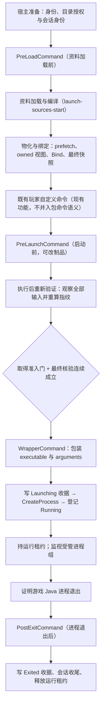

# MMC 二期命令能力阶段契约（冻结稿）

状态：**待 owner 冻结**（本文档本身即 [设计 7.1](mmc-instance-design.md#71-cfg-的有效行为能力表) 所要求的「启用命令能力前的阶段契约」）。
基线：分支 `work/mmc-compatibility`，HEAD `d1ebd107`。范围见[二期待办](mmc-phase2-todo.md)。
本文档只写契约、不改任何源码；`MmcConfigurationReader` 的放行开关按第 8 节判定表在对应实现与 fixture 落地后才逐项打开。

## 0. 范围、非目标与依据约定

| 项 | 内容 | 依据 |
| --- | --- | --- |
| 冻结对象 | 资料加载前 / 启动前 / Java 包装 / 进程退出后四阶段；GameRoot 工作目录；INST_DIR、INST_MC_DIR；子进程所有权；取消收尾；允许的派生输出；执行后重新验证 | 设计 L337 |
| 本文档覆盖 | 包内命令（PreLoad/PreLaunch/PostExit）与 Wrapper 进程所有权；Env、console／PermGen 只在交叉处点到 | 待办 L9-16；设计 L333-335 |
| 非目标 | 不把 cfg `WrapperCommand` 当作 ForgeWrapper／PCL JavaWrapper 已支持；不承诺技术上阻止任意外部进程写入 | 设计 L337、L347、L439 |
| 依据格式 | 每条契约标注「文档行号」或 `文件:行`；无依据处标 **待定 Dx**，见第 10 节 | 本任务硬性要求 |
| 语义纪律 | 未知编码或无法兑现的要求明确拒绝；不静默丢弃、不凭字段名猜语义 | 设计 L317、L325、L337；兼容范围 L17-18 |
| 冻结轮次 | 第一轮冻结契约并把 15 项列为待定；第二轮用**仓库自身先例**定掉 11 项（D1–D5、D7–D11、D14），保留 4 项 owner 决策（D6、D12、D13、D15）与 1 项实现期残值（D8-残余）。已定项从第 10.2 节移除并回填各章附依据，清单见第 10.1 节 | 本任务第二轮要求 |
| 行号约定 | 本文引用的 `文件:行` 是**撰写时**的快照。`MmcConfigurationReader.cs` 会随二期各项落地持续增行（Env 与命令三阶段已使其从 154 行增至 187 行），因此**以引用的代码语义为准，行号仅供定位**。查找方法：命令三阶段放行看 `foreach (string command in new[] { "PreLoadCommand", ... })`；Wrapper 拒绝看 `Unsupported("cfg:WrapperCommand", ...)`；Env 放行看 `MmcEnvironmentReader` 调用点 | lead 验收裁定 R-4 |
| 实现进度 | 见第 12 节。契约本身不表示某项已接通；放行以「该字段的放行与实现 + fixture 同时落地」为准（第 8 节） | 设计 L337、L620 |

## 1. 阶段契约：四阶段时机与插入点

### 1.1 阶段总序

### 1.2 逐阶段契约

| 阶段 | cfg 字段 | 精确触发时机 | 允许的插入点（现有文件:行） | 依据 |
| --- | --- | --- | --- | --- |
| 资料加载前 | `PreLoadCommand` | 在**本次启动的实例运行输入开始加载（`launch-sources-start`）之前**执行；执行完才进入来源加载、编译、prefetch、物化与绑定 | 必须晚于宿主准备（`MmcLaunch.cs:73-94`：路径解析、来源读取、偏好捕获、登录等待、Java 选择）与可选的变体采用（`MmcLaunch.cs:100-109`）；必须在 `PrepareLaunchAsync`（`MmcLaunch.cs:110`）与首个资料进度点 `MmcRuntimeLaunchBuilder`／backend 的 `launch-sources-start`（`MmcInstanceBackend.Launch.cs:32-33`）之前 | 设计 L337（阶段名）；待办 L9；**已定 D1** |
| 启动前 | `PreLaunchCommand` | 在物化、绑定、最终快照之后，**创建进程与写 Launching 收据之前**执行 | `MmcLaunch.cs:166`（`BuildAsync`）与 `MmcLaunch.cs:182`（`MmcSessions.Launch`）之间；进程创建点是 `MmcRuntimeLaunchContracts.cs:95 CreateStartInfo()` | 设计 L337（「PreLaunch 可能改变制品，执行后不能继续沿用旧指纹」）；待办 L10 |
| Java 包装 | `WrapperCommand` | 不改变阶段顺序，改变**最终命令行的组成**：包装程序构成入口，Java 为其子进程 | 最终 argv 装配点 `MmcRuntimeLaunchBuilder.cs:93-110`；进程创建 `MmcRuntimeLaunchContracts.cs:95-107`；可注入点 `PCLCS/Launch/LegacyLaunchHost.cs:73 StartProcess` | 设计 L337（与 ForgeWrapper／PCL JavaWrapper 是不同能力）；待办 L13-14 |
| 进程退出后 | `PostExitCommand` | 在**游戏 Java 进程被证明退出之后执行**：**写退出收据之后、会话收尾与释放运行租约之前**，并覆盖于既有退出监视重试循环内（不得在收据之前执行） | 退出确认 `MmcSessions.cs:106-119 CompleteOwnedExit`、`MmcLaunch.cs:283-300 MonitorExitAsync`；次序证据 `MmcLaunch.cs:288`（写收据）→ `289`（等待监视收尾）→ `290-292`（释放会话）；收尾点 `MmcSessionRuntimeDirectories.cs:83-85` | 设计 L337；待办 L14；设计 L465（运行租约持有到「必要退出收尾结束」）；**已定 D9** |

| 顺序硬约束 | 内容 | 依据 |
| --- | --- | --- |
| 阶段不可乱序 | 四阶段按上表固定顺序；任一阶段失败时的处置按第 7 节，不得跳过后继续下一阶段 | 设计 L337（四阶段定义） |
| 收据必须先于命令 | `Launching.record` 的 `RuntimeFingerprint` 就是本次启动采用的输入指纹，因此 PreLaunch 与执行后重验必须发生在写收据之前 | `MmcSessions.cs:44-47`、`MmcLaunch.cs:182`、设计 L467 |
| 最终核验连续性 | 「最终快照验证 → 实际制品核验 → CreateProcess → Running 登记」之间不得中途释放再检查 | 设计 L461 |
| 阶段顺序与既有命令步 | 既有玩家命令仍是 `MmcLaunch.cs:42` 的独立「执行自定义命令」步；包命令不得合并进该步 | 设计 L333；兼容范围 L49 |
| 玩家命令与包命令的次序 | **玩家命令在前、包阶段命令按四阶段插入**，两者来源可区分。仓库既有次序是「全局 `LaunchAdvanceRun` → 实例 `VersionAdvanceRun`」，即玩家侧命令先执行；包阶段命令不得改变或重排既有玩家命令 | `LegacyLaunchProcess.cs:33-34`（先 global 后 version）、`LegacyLaunchProcess.cs:16-20`；`MmcLaunchPreferences.cs:87-88`；**已定 D4** |
| 包命令的启用前提 | 格式档位不支持的包命令必须在导入期拒绝，宿主**绝不推断或执行未知命令** | `MmcLaunch.cs:130-131` 原文注释；设计 L333、L337 |
| 用户确认沿用既有形态 | 用户确认使用既有确认对话框先例，不新造确认机制（**确认粒度**仍见 D13） | `MmcLaunch.cs:28-30`（`ConfirmVariantAdoption` 经 `ModBase.RunInUiWait` + `ModMain.MyMsgBox`，含「取消」分支并抛 `OperationCanceledException`） |
| 不得走旧旁路 | 禁止把包内 `PreLaunchCommand` 写入 `VersionAdvanceRun`／Setup.ini 交给普通实例路径执行；禁止复用 `ArgumentReplace` 的 `{...}` 占位体系承载包命令 | 设计 L333；`ModpackInstallLocal.cs:56-64`；`LegacyLaunchProcess.cs:16-52`；`MmcLaunch.cs:128-142` |

### 1.3 命令执行方式、退出码与日志脱敏（由仓库自身先例定）

| 项 | 契约 | 依据 |
| --- | --- | --- |
| 执行宿主（**已定 D3**） | 包命令沿用受管命令先例：`cmd.exe` + `ArgumentList` 依次为 `/d`、`/s`、`/c`、命令文本；**不得**使用整串 `Arguments = "/c \"{command}\""` 的字符串拼接形式 | 受管先例 `MmcLaunch.cs:134-136`；被禁止的对照形式 `LegacyLaunchProcess.cs:40-43`；`MmcSessions.cs:123`（受管进程禁止用整串 `Arguments`） |
| 为何不用旧形式 | 旧形式把命令拼进一个字符串并由 shell 再解析，引号/转义面不可控；旧路径同时是设计 L333 明令禁止包命令沿用的旁路 | 设计 L333；`LegacyLaunchProcess.cs:16-52` |
| 工作目录 | `WorkingDirectory = paths.GameRoot`；与受管先例及第 2 节一致 | `MmcLaunch.cs:134-135`；`MmcSessions.cs:124-126` |
| 启动即失败 | 进程无法创建（`Process.Start` 返回 null）→ 立即抛出，按第 7 节 F-05 处理 | `MmcLaunch.cs:137` |
| 非零退出码（**已定 D5**） | 按阶段区分：**PreLoad／PreLaunch 非零 → 拒绝启动**（两者都可能改变制品，须进入 F-06 的重新验证与拒绝路径）；**PostExit 非零 → 仅记录诊断**，不回滚已结束的会话、不重写退出收据 | 仓库两处先例都不检查退出码（`MmcLaunch.cs:137-140`、`LegacyLaunchProcess.cs:44-51`），故「仅告警」会与设计 L337「无法兑现的要求明确拒绝」冲突；阶段区分依据设计 L337、F-06、F-15 |
| 退出码记录 | 需要记录时使用现有退出码形态（十进制 + `0x` 十六进制） | `MmcLaunch.cs:247-248` |
| 等待策略 | 随命令记录决定是否阻塞等待；等待期间响应取消，不得无界阻塞 | `MmcLaunch.cs:138-140`；`MmcLaunchPreferences.cs:23`（`WaitForExit`） |
| 取消 | `Kill(entireProcessTree: true)`（整树终止，覆盖 cmd 及其派生子进程）；与第 4.2 节收尾一致 | `MmcLaunch.cs:140,220,224,232,239`；待办 L14 |
| 日志脱敏（**已定 D14**） | 沿用仓库既有脱敏先例（`FilterAccessToken` 形态）对命令文本做脱敏后才可入日志；**不得落展开后原文**；受管运行期的日志出口必须经过计划自身的脱敏函数 | `LegacyLaunchProcess.cs:27`（`host.FilterAccessToken(command, 'F')`）；`MmcRuntimeLaunchContracts.cs:108-111`（`Redact`）；`MmcLaunch.cs:217`（`LogRedactor: runtime.Redact`）；待办 L13；设计 L319 |
| 日志顺序 | 日志入队前完成脱敏，不得先记录后补救 | `mmc-development.md:106`（「日志入队前脱敏」） |

## 2. 工作目录契约

| 契约 | 取值 | 依据 |
| --- | --- | --- |
| 四阶段统一 cwd | `paths.GameRoot` = `InstanceRoot/Layout.GameRootLeaf`（叶名只允许已验证的 `minecraft` 或 `.minecraft`） | 设计 L337（要求冻结「GameRoot 工作目录」）、L225（「进程工作目录指向 GameRoot」）、L223；`MmcSessions.cs:124-126`（强制等于 GameRoot）；`MmcRuntimeLaunchContracts.cs:98` |
| 游戏进程 cwd 与 `-Duser.dir` | 同为 GameRoot；其他取值明确拒绝 | `MmcRuntimeLaunchBuilder.cs:70,76,247-254`（`MMC_RUNTIME_WORKING_DIRECTORY`） |
| 玩家手动命令 cwd | GameRoot（既有行为，保持） | `MmcLaunch.cs:135` |
| 相对路径解析 | 一律相对 cwd=GameRoot 解析为绝对路径；**不得**用 InstanceRoot 或版本根代替 | 设计 L225（「不能统一替换成版本根」） |
| 变量与路径角色的区分 | `$INST_DIR` → InstanceRoot；`$INST_MC_DIR` → GameRoot；两者不得混用 | 设计 L225；`MmcRuntimeLaunchBuilder.cs:166-167` |
| 目录角色校验 | 任何阶段的路径都要过 `EnsureNoLinks` 与角色检查；GameRoot 缺失即拒绝启动 | `MmcInstancePaths.cs:44-48,96-106`；`MmcSessions.cs:127-128` |
| 不变量 | 命令不得被理解为「工作目录=版本根」；`minecraft/libraries` 与 `libraries` 仍是两个角色 | 设计 L225、L382；兼容范围 L39-40 |

## 3. 变量与展开契约

| 契约 | 内容 | 依据 |
| --- | --- | --- |
| 变量集合 | 复用运行期变量字典：`profile_name`、`version_name`、`version_type`、`game_directory`、`instance_directory`、`INST_DIR`、`INST_MC_DIR`、`assets_root`、`assets_index_name`、`game_assets`、`library_directory`／`libraries_directory`、`natives_directory`、`classpath`、`classpath_separator`、`primary_jar`、`launcher_name`、`launcher_version`、`resolution_width`／`resolution_height`、`mmc_logging_config` | `MmcRuntimeLaunchBuilder.cs:160-179` |
| 凭据变量 | 包内命令**不得**绑定 `auth_*`、`access_token`、`auth_session`、`user_type`、`user_properties`、`auth_xuid`、`clientid`、`client_token`；出现即按无法兑现拒绝 | 设计 L319（登录信息临时绑定、不进入持久化计划或证明日志）、L337；该禁令是否也适用于玩家手动命令见 **待定 D12** |
| 写法 | 同时接受 `${name}` 与裸 `$INST_DIR`／`$INST_MC_DIR`（后两者有单词边界判定）；`$` 后无匹配键时按字面 `$` 输出 | `MmcRuntimeLaunchBuilder.cs:187-196` |
| 展开时机（**含已定 D2**） | 只在「该阶段即将执行之前」、以本次启动已冻结的快照做一次展开；展开结果不写回定义、不参与指纹。**准入门关系**：命令在准入门**外**执行，执行完成后重新取门并做一次完整最终核验；不得在持门状态下执行外部命令（避免长命令阻塞准入门、避免自锁） | 设计 L378、L386（先算键再映射路径）、L461（只要求「最终核验→CreateProcess→Running 登记」连续）、L445（不得持准入门等待运行/退出）；仓库先例 `MmcLaunch.cs:42`（「执行自定义命令」是独立步，位于 `Start` 步之外）与 `MmcLaunch.cs:162`（准入门只在 `Start` 步内获取）；`MmcRuntimeLaunchBuilder.cs:180-208`；**已定 D2** |
| 未定义变量 | 明确失败（`MMC_RUNTIME_VARIABLE`），不得静默替换为空串 | `MmcRuntimeLaunchBuilder.cs:197`；设计 L337 |
| 非法字符 | NUL 出现在模板或展开结果即失败 | `MmcRuntimeLaunchBuilder.cs:181,201` |
| 长度预算 | 命令字符串沿用既有实例命令上限（16384 字符、禁 NUL）；包装后的命令行仍须满足 32767 上限 | `MmcLaunchPreferences.cs:92`；`MmcRuntimeWindowsCommandLine.cs:11-36`（`MMC_RUNTIME_COMMAND_LENGTH`） |
| 与 `+jvmArgs` 的区别 | `+jvmArgs` 数组每个元素就是**一个参数**，含空格不再切分；不得把命令文本按该语义并入 argv | 设计 L306、L321；兼容范围 L27 |
| 与 `minecraftArguments` 的区别 | `minecraftArguments` 用固定 prism-v1 的字面空格拆分；命令字符串**不是**启动参数串，必须作为命令文本另行解析 | 兼容范围 L26；设计 L321 |
| 与 cfg `JvmArgs` 的区别 | cfg `JvmArgs` 走相应格式的命令字符串解析后产出 JVM 参数；包命令产出的是一次外部执行，两者不得互相转换 | 设计 L321；待办 L12 |
| 允许的分词器 | 命令字符串若需要 token，只能使用命令串分词器 | `MmcArgumentTokenizer.cs:7`（注释明确：native minecraftArguments 与 `+jvmArgs` 成员永不经过该解析器） |
| 展开与 token 的次序 | 先展开变量，再按所选执行方式（shell 或 argv）处理；**只做一次**平台转义，且只发生在最终进程边界 | 设计 L321（「宿主仅在最终进程边界进行一次平台转义」） |
| 禁混用清单 | 不得经过旧 `SplitJavaArguments`／`DeduplicateJavaArguments`；不得经过 `ModMain.ArgumentReplace`；不得写入 `VersionAdvanceRun` | 设计 L319、L333；`ModMain.cs:323-326`；`LegacyLaunchProcess.cs:16-52` |

## 4. 子进程所有权、取消收尾与退出判定

### 4.1 所有权

| 问题 | 契约 | 依据 |
| --- | --- | --- |
| 谁创建 | 宿主（LF）创建全部受管进程：包命令进程、包装程序、Java 游戏进程。Core 只出计划，不创建进程 | 设计 L28（宿主承担副作用执行）；`MmcRuntimeLaunchContracts.cs:63`（计划明确无 Start 方法） |
| 谁等待 | 宿主按阶段序列等待；等待策略随命令记录，不隐式后台化 | `MmcLaunch.cs:41-45`（阶段步）；`MmcLaunch.cs:138-140`（按 `WaitForExit` 阻塞）；`MmcLaunchPreferences.cs:23`（等待策略随命令记录） |
| 进程登记 | 受管进程必须登记 PID、创建时间、镜像身份；不得 `UseShellExecute`、不得用整串 `Arguments` | `MmcSessions.cs:54,123,129-139` |
| 凭证/nonce 保护 | 包与用户参数不能覆盖内部会话 nonce；nonce 由宿主注入 | `MmcSessions.cs:49,137`；设计 L467 |
| 包装程序的双重身份 | 包装模式下必须同时登记**入口进程**（包装程序）与**受管 Java 进程**；退出判定只认后者 | 待办 L13-14；`MmcSessions.cs:15`（现行注释：包装派生子进程需要另行验证的宿主支持） |
| 环境通道 | 受管 Java 进程必须继承已净化的环境：移除 `JAVA_TOOL_OPTIONS`／`JDK_JAVA_OPTIONS`／`_JAVA_OPTIONS`／`CLASSPATH`，`TEMP`／`TMP` 指向本次会话可变目录 | `MmcRuntimeLaunchContracts.cs:103-105`；核验方式 **已定 D11**，见下表 |
| Java 身份与 pin | 包装不得绕过 Java 身份核验与 Java pin；pin 覆盖 Launching／Running／退出收尾 | `MmcSessions.cs:35-38`；设计 L392 |

### 4.2 取消收尾顺序

| 步骤 | 动作 | 依据 |
| --- | --- | --- |
| 1 | 标记取消，阻止尚未开始的后续阶段；已开始的阶段保持既定处置 | `MmcLaunch.cs:130,220,229-235` |
| 2 | 终止**整个受管进程组**：包装程序与其 Java 子进程都必须在收尾范围内，不能只终止其中一个 | 待办 L14（「取消与退出确认覆盖整个受管理进程组」） |
| 3 | 终止原语沿用仓库既有形式：`Kill(entireProcessTree: true)` | `MmcLaunch.cs:140,220,224,232,239`；**已定 D8**（原语部分） |
| 4 | 终止后必须**证明**进程不存在，再进入收尾；不能以「已发出 Kill」代替证明 | 设计 L469；`MmcSessions.cs:111-115` |
| 5 | 存在不可证明的残留时保持 `Unknown`：保留会话收据与 Java pin，禁止自动删收据、禁止杀其他进程、禁止结构写入 | 设计 L469；`MmcSessions.cs:88,219` |
| 6 | 未写 `Launching.record` 的失败可退役本次新建的可变目录；已写收据只能走会话重放 | `MmcSessionRuntimeDirectories.cs:65-81`；`MmcLaunch.cs:193-202` |
| 7 | 有界等待（**已定 D8**，残项）：终止后进入有界等待并重试证明，候选 **3 秒**——取自仓库既有退出确认重试间隔；**未运行状态探测的超时上限仍需定值**（无仓库先例，不自行发明） | 3 秒依据 `MmcLaunch.cs:297`（`Task.Delay(3000)`）；`MmcLaunch.cs:239`（100ms 级轮询只用于已可判定状态）；上限 **待定 D8-残余** |

### 4.3 「包装程序先退出 ≠ 游戏已退出」判定表

判定要素来自现有保守进程观察契约与崩溃恢复要求：只有「受管 Java 进程被证明已退出」才能判退出，包装程序的自身状态不构成退出证据。

| 观察 | 判定 | 允许动作 | 依据 |
| --- | --- | --- | --- |
| 入口进程（包装程序）已退出，携带本次 nonce 的 Java 进程**被证明仍存活** | 会话仍运行 | 不得写 `Exited.record`、不得释放运行租约；只记录一条诊断 | 待办 L14；`MmcSessions.cs:177-181`；设计 L467 |
| 入口进程已退出，Java 进程**被证明不存在或从未产生** | 已退出 | 允许写退出收据并进入 PostExit 与收尾 | `MmcSessions.cs:81-92`；设计 L469 |
| 入口进程存活但镜像身份/创建时间与登记不符（含 PID 重用） | 待确认 `Unknown` | 保持只读待确认，禁止当作已退出 | `MmcSessionContracts.cs:54-65` |
| 非本次会话的 Java 进程存在（身份或 nonce 不符） | 与本次会话无关 | 不得当作游戏进程，也不得终止 | 设计 L469（禁止杀其他进程） |
| 无法读取进程信息（无权限、身份不符） | 待确认 `Unknown` | 保持只读待确认 | `MmcSessionContracts.cs:66-67`；设计 L469 |

判定所依据的可观察量（必须全部核对，不能只看 PID）：

| 要素 | 用途 | 依据 |
| --- | --- | --- |
| 进程镜像 SHA256 等于所选 Java 身份 | 排除「另一个 java.exe」 | `MmcSessions.cs:52-53,96-104`；设计 L469 |
| 登记创建时间一致 | 排除 PID 重用 | `MmcSessions.cs:54,112`；设计 L469 |
| 命令行含本次会话 nonce（仅内存匹配，不落日志） | 证明是本次受管 Java 进程 | `MmcSessionContracts.cs:65`；设计 L467、L469 |
| 受管进程组内无其他存活成员 | 覆盖包装程序的派生进程 | 待办 L14 |
| 退出收据 `Proof` 取值（**已定 D7**） | 已定：需要**新增一个证明来源值**（如 `WrapperManagedExit`），理由（a）现有枚举 `OwnedProcessHandleExited` 语义等于「进程句柄本身退出」，包装模式下先退出的恰是包装程序，直接沿用会**在语义上把「包装先退出」当成游戏已退出**，与待办 L14 冲突；（b）`TrustedHostProcessObservation` 是「宿主受控检查本用户进程」的保守观察，不等价于本会话的**句柄级**退出证明。新增值仍需同时登记**两个进程身份**（包装入口 + 受管 Java） | `MmcSessions.cs:177-185`（`WriteExit`／`ValidateExit` 的封闭枚举）、`MmcSessions.cs:106-119`（句柄级证明路径）、`MmcSessionContracts.cs:29-30`（登记记录只有一个进程字段）；待办 L14；设计 L469 |

**D11【已定】包装链环境净化的核验边界**：`CreateStartInfo` 只清理继承环境；对包装程序的子进程**不做也不声称技术强制**。因此包装模式下「子进程环境未被观察」按第 7 节 F-08 处理；`TEMP`／`TMP` 指向本次会话可变目录的保证仅覆盖受管入口进程。核验范围与拒绝条件仍属实现期 fixture 内容。

## 5. 允许的派生输出契约

| 位置 | 命令可否写入 | 说明 | 依据 |
| --- | --- | --- | --- |
| GameRoot 内玩家/游戏数据（mods、config、logs、saves、resources 等） | 允许 | 与普通游戏写入同一角色；仍受活动会话结构写门禁约束 | 设计 L225、L463；`MmcInstancePaths.cs:62-66` |
| `PCL/MmcRuntime/<viewKey>/**`（已校验输入视图、native、assets、support） | **禁止** | 活动期间禁止重建/覆盖/清理该视图；Wrapper 可变生成输出必须放独立 owned 目录 | 设计 L382、L384 |
| `libraries/**`（InstanceLocal 平面库）与共享来源副本 | **禁止** | 运行租约保护；不符已锁定摘要只能重试来源或拒绝，不能原地更新 AdoptedSha256 | 设计 L382 |
| `PCL/MmcArtifacts/sha256/**`（不可重取原件对象库） | **禁止** | 原件是持久环境，不属于 Derived，不随 Derived 清理 | 设计 L370、L518 |
| `PCL/InstanceDefinition.json`、`<实例名>.json`、来源快照、锁记录 | **禁止**（只能经结构事务） | 结构写必须确认没有活动/待确认会话，并走 Prepared→CommitDecided 事务 | 设计 L396、L423-428、L443 |
| `PCL/MmcSessions/**`、`PCL/MmcSessionHistory/**`、事务目录 | **禁止** | 收据与清理都由会话/事务身份授权 | `MmcSessions.cs:19-63,177-195`；`MmcSessionRuntimeDirectories.cs:83-118`；设计 L503 |
| 其他实例路径、全局共享 Maven 缓存、Java 安装目录 | **禁止** | 不把实例租约扩大成全局保护；也不得改写共享来源 | 设计 L463、L390、L497 |
| 命令自身声明的输出位置 | 允许，但必须登记 | 输出的实际路径与其**再次被读取的方式**要纳入计划与会话验收 | 设计 L384 |
| 已采用输入的原地改写 | **禁止** | 「物化后必须验证副本等于已锁定摘要，不符则重试来源/拒绝，不能原地更新 AdoptedSha256」 | 设计 L382 |
| 强制手段的现实边界 | 声明可信，不做技术阻止承诺 | 「不承诺阻止任意外部进程在 hash 检查与替换之间写入」；越界写入由第 6 节重验捕获并拒绝 | 设计 L439 |
| 派生输出的登记形态（**已定 D10**） | 已定：**不新增 `MmcDerivedOutputKind`**。第 6/7 节的重验不在定义里增加字段；命令产生的变化一律作为「违反已锁定摘要」被拒绝，合法改变必须走显式变体/修复/定义修改 → 新代数 → 重新物化 → 重建计划 | 设计 L378（采用新变体才产生新代数）、L382（不得原地更新 AdoptedSha256）、L337（重验规则与阶段契约同时冻结）；定义校验现有 4 类输出见 `MmcDerivedModels.cs:9-13`、`MmcDefinitionCodec.cs:306-350`；新增字段属格式级变更，本契约不据此修改冻结格式 |

## 6. 执行后重新验证契约

「PreLaunch 可能改变制品，执行后不能继续沿用旧指纹」是本节唯一的总纲；下表是它的可执行化。

| 项 | 契约 | 依据 |
| --- | --- | --- |
| 强制触发点 | PreLoad 与 PreLaunch 结束之后、以及「热缓存命中／同计划复用」路径，都必须重新观察一次全部输入，不得以缓存命中为由跳过 | 设计 L337；设计 L382（「运行前以及热缓存命中时核验的是实际 owned 副本」）；设计 L471（热计划命中仍须执行相同核验） |
| 重验时机（相对收据） | 必须在构造 `Launching.record` 之前完成，因为收据的 `RuntimeFingerprint` 即本次采用的输入指纹 | `MmcSessions.cs:44-47`；`MmcLaunch.cs:182`；设计 L467 |
| 重验时机（相对进程创建） | 重验与 CreateProcess、Running 登记之间连续持有准入门，中间不得释放再检查 | 设计 L461 |
| 重验范围 1：运行输入 | 全部 `artifact:*`、`derived:*`、`support:*`（owned）与 `java:*`（非 owned）观察项重算摘要与长度 | `MmcRuntimeLaunchBuilder.cs:38,44-48,53,125-137`；`MmcRuntimeFiles.cs:37-47`（`MMC_RUNTIME_INPUT_CHANGED`） |
| 重验范围 2：classpath 清单输入 | 清单内被锁定类的存在/缺失复检 | `MmcLaunch.cs:167,191`（`ObserveAsync`／`RevalidateManifestInputs`）；`MmcRuntimeLaunchBuilder.cs:92` |
| 重验范围 3：绑定启动文件与定义 | 已绑定启动文件（含 preserved、adopted、derived）逐字节核对；定义/代数/投影未变；无 pending、无活动会话 | `MmcInstanceBackend.Launch.cs:109-121,144-158`；`MmcSessions.cs:143-159` |
| 重验范围 4：可变目录所有权 | 会话可变目录路径与所有权标记仍属于本次会话 | `MmcRuntimeLaunchBuilder.cs:135,264-271`；`MmcSessionRuntimeDirectories.cs:55-62` |
| 重验范围 5：命令行 | 包装或命令导致的 argv 变化后重算 Windows 命令行长度（含 nonce 预留） | `MmcRuntimeLaunchBuilder.cs:113`；`MmcRuntimeWindowsCommandLine.cs:32-36` |
| 指纹重算 | 输入指纹必须用**重验后**的观察集合重算；不得沿用命令执行前的旧值 | `MmcRuntimeLaunchBuilder.cs:125-127`；设计 L337 |
| 摘要不符时的处置 | 明确拒绝本次启动；不得就地采纳当前字节、不得原地更新 AdoptedSha256 | 设计 L382；设计 L519 |
| 若 PreLaunch 合法需要改制品 | 只能走「显式变体采用／修复或定义修改 → 新代数 → 重新物化 → 重新生成最终启动计划 → 再取最终准入」的路径，且必须在该结构事务完成后再重新解析新代数 | 设计 L378；设计 L423-428；设计 L461 |
| 失败回退：未写收据 | 不创建进程；退役本次新建的可变目录；定义与来源不动；允许修复后重试 | `MmcLaunch.cs:193-202`；`MmcSessionRuntimeDirectories.cs:65-81` |
| 失败回退：已写收据 | 只能走会话重放；不可证明时保持只读待确认，禁止自动删收据或结构写入 | `MmcSessions.cs:72-94`；设计 L469 |
| 第三方内容介入 | 保留现场并进入 `RecoveryRequired`，不自动覆盖 | 设计 L425、L437 |

## 7. 失败与拒绝契约（失败模式表）

判定原则：**能力缺失、编码未知、要求无法兑现 → 拒绝启动；描述性差异、非活动值 → 仅告警或记录**。

| 编号 | 失败模式 | 处置 | 依据 |
| --- | --- | --- | --- |
| F-01 | cfg 无法完整解码（未知转义、未支持 list、QVariant、非法布尔、重复键、未知 ConfigVersion） | 拒绝（读取期即失败） | `MmcConfigurationReader.cs:43,63,73,94-97,128,144`；兼容范围 L17-18 |
| F-02 | 有效布尔/转义非法 | 拒绝，不得按 `false` 吞掉 | 设计 L325 |
| F-03 | 命令文本含 NUL 或超过长度上限 | 拒绝 | `MmcLaunchPreferences.cs:92`；`MmcRuntimeLaunchBuilder.cs:181` |
| F-04 | 命令引用未定义变量或凭据变量 | 拒绝（无法兑现） | `MmcRuntimeLaunchBuilder.cs:197`；设计 L319、L337 |
| F-05 | 命令无法创建（入口不存在、路径非法、非绝对、目录角色冲突） | 拒绝启动 | `MmcLaunch.cs:137`；`MmcInstancePaths.cs:74-86` |
| F-06 | PreLoad／PreLaunch 执行后输入摘要与已锁定值不符 | 拒绝启动，并要求显式修复／新代数 | 设计 L337、L382 |
| F-07 | 包装后命令行超过 32767 | 拒绝 | `MmcRuntimeWindowsCommandLine.cs:32-36` |
| F-08 | 包装程序身份/环境通道无法核验，导致 JVM 输入可能未被观察 | 拒绝（不得降级为「大概没问题」） | `MmcRuntimeLaunchContracts.cs:103-105`；同族拒绝见 `MmcRuntimeLaunchBuilder.cs:212-216`（`MMC_RUNTIME_UNBOUND_INPUT`）；设计 L337 |
| F-09 | 包装程序先退出但游戏未退出 | 不得判退出、不得收尾；记录诊断 | 待办 L14 |
| F-10 | 退出不可证明 | 保持 `Unknown`、保留收据与 pin、保持只读待确认 | 设计 L469；`MmcSessions.cs:88` |
| F-11 | 命令写入禁止位置 | 由第 6 节重验捕获→拒绝；不承诺技术阻止 | 设计 L439、L382 |
| F-12 | 会话可变目录清理遇到外部改动 | 保留所有权证据并报错，不继续清理 | `MmcSessionRuntimeDirectories.cs:116-117` |
| F-13 | 活动会话期间的结构写请求 | 直接拒绝（忙碌／入队），不得等待运行租约释放 | 设计 L443、L445 |
| F-14 | 命令非零退出码 | **已定 D5**：PreLoad／PreLaunch 非零 → 拒绝启动并进入 F-06 重验/拒绝路径；PostExit 非零 → 仅记录诊断 | 仓库两处先例均不检查退出码（`MmcLaunch.cs:137-140`、`LegacyLaunchProcess.cs:44-51`）；阶段区分见第 1.3 节；设计 L337 |
| F-15 | PostExit 自身失败 | 记录明确诊断，不回滚已结束的会话，不重写退出收据 | 设计 L465；`MmcSessions.cs:177-185` |
| F-16 | 用户手动命令与包命令同时非空 | **已定 D4**：两套路径都执行、来源可区分；**玩家命令在前**，包阶段命令按四阶段插入 | `LegacyLaunchProcess.cs:33-34`（全局 → 实例）；设计 L333；兼容范围 L49 |
| F-17 | 命令文本进入日志 | **已定 D14**：入队前用既有脱敏形态（`FilterAccessToken` / 计划 `Redact`）处理，不得落展开后原文 | `LegacyLaunchProcess.cs:27`；`MmcRuntimeLaunchContracts.cs:108-111`；`MmcLaunch.cs:217`；`mmc-development.md:106` |

## 8. 能力门判定表（`MmcConfigurationReader` 目标态）

现行行为：`OverrideCommands`／`OverrideLaunchCmd` 生效时，四个命令字段任一非空即按 `Unsupported(..., required:true)` 拒绝；`OverrideEnv` 生效且 `Env` 非空同样拒绝。该判定在启用来源（enabled=true）时产出 Error，非活动来源产出 Warning 并保留原值。

| 字段／情形 | 现行 | 契约落地后的目标态 | 仍拒绝的情形 | 依据 |
| --- | --- | --- | --- | --- |
| `PreLoadCommand` 非空且生效 | 拒绝 | 放行（进入资料加载前阶段） | 值无法解码、含 NUL／超长、引用未定义或凭据变量、F-06 | 设计 L333、L337；`MmcConfigurationReader.cs:79-82` |
| `PreLaunchCommand` 非空且生效 | 拒绝 | 放行（进入启动前阶段 + 执行后重验） | 同上，且重验失败即拒绝 | 设计 L333、L337 |
| `WrapperCommand` 非空且生效 | 拒绝 | 放行（包装入口，Java 为子进程） | F-07、F-08、无法登记双身份时拒绝 | 设计 L333、L337；待办 L13-14 |
| `PostExitCommand` 非空且生效 | 拒绝 | 放行（游戏退出证明之后） | 值无法解码或无法兑现 | 设计 L333、L337 |
| `Override=false`（源中不生效） | 保留 + Warning | **保持**：仅保留原值并告警，不执行、不报错 | — | 设计 L333（「Override=false 时源中不生效的值仅保留」） |
| `OverrideCommands` 与旧别名 `OverrideLaunchCmd` 同时存在 | 新键优先 + `MMC_CFG_ALIAS` 告警 | **保持** | 取值非法时按 F-02 拒绝 | 设计 L325；`MmcConfigurationReader.cs:75-78` |
| 判定次序 | 直接看字段值 | **保持「先算 Override／继承后的有效行为，再判定能力」**；宿主继承的实际用户命令非空也须过能力检查 | 不得把未列入能力表的 cfg 行为静默丢掉 | 设计 L325、L333 |
| `OverrideEnv`／`Env` | 拒绝 | 由 Env 项独立放行；命令子进程是否继承已生效 Env **待定 D15**（需 owner） | 未知编码或无法兑现的要求拒绝 | 设计 L334；待办 L12 |
| `OverrideGameTime`／`OverrideNativeWorkarounds` | 拒绝（enabled）／告警（inactive） | **保持拒绝**（不在本契约范围） | — | `MmcConfigurationReader.cs:85-86`；设计 L334 || `PermGen`、`OverrideConsole`／console 系列 | 读取保留 | **保持非本契约范围**；只保留与命令的交叉点：关闭独立控制台不得映射为关闭整个 PCL | 无等价展示选项给明确差异诊断 | 设计 L335；待办 L15-16 |
| 能力门开关时机 | — | 本契约只是前置；每个字段的放行必须与该阶段的实现和 fixture 同时落地，未落地前**保持拒绝** | 未验证即放行 | 设计 L337；设计 L620（P0 式实证要求） |

## 9. 边界条件汇总表

| 边界 | 契约 | 依据 |
| --- | --- | --- |
| 中文路径、空格路径 | 必须可用；变量注入的是绝对路径（正斜杠 Java 形式） | `MmcRuntimeFiles.cs:16-23`；兼容范围 L31 |
| `INST_DIR` 与 `INST_MC_DIR` 同时出现 | 允许；分别指向 InstanceRoot 与 GameRoot | 设计 L225 |
| 两棵游戏树（`minecraft` 与 `.minecraft` 同时存在） | 只以选中的一棵为 GameRoot；未选树保留为独立角色，不并入、不作为活动 GameRoot | 设计 L223、L497 |
| `libraries/a.jar` 与 `minecraft/libraries/a.jar` 同名异内容 | 合法且必须同时正确解析 | 设计 L225；MMC-16（L641） |
| 同一实例并发会话 | 仅允许一个活动游戏会话；活动期间结构写、修复、组件修改、还原、改名、删除全部拒绝 | 设计 L463 |
| 宿主先死／CreateProcess 与 PID 登记之间崩溃 | 持久收据让合作写入者视为待确认；恢复需创建时间、Java 身份、会话 nonce；不得自动删收据或杀他人进程 | 设计 L469 |
| 宿主窗口隐藏/关闭 | 监视器后台保活；活动会话期间不支持真正结束监视器；不得偷改全局退出偏好 | 设计 L465 |
| 热计划命中 | 仍须执行相同准入与字节核验 | 设计 L461、L471 |
| 登录等待期间发生结构写 | 允许；但本次启动之后必须重新解析新代数，不得用旧 N 代数访问 N+1 字节 | 设计 L461 |
| 路径含 `=`（javaagent 分离符） | 受控执行域构造时明确拒绝 | `MmcSessionRuntimeDirectories.cs:29-32` |
| 原生加载器路径预算 | 受控可变目录必须满足 260 字符预算（含 128 后缀余量） | `MmcSessionRuntimeDirectories.cs:12-13,21-28` |
| 外部进程并发写入 | 只覆盖 LF 合作写入者，不承诺 CAS | 设计 L439 |
| 跨实例隔离 | 其他实例改写同坐标全局来源不得影响本实例已核验 owned 副本 | 设计 L463；MMC-21（L646） |

## 10. 待定项清单

### 10.1 第二轮已定项（11 项，已回填各章）

| 编号 | 结论 | 依据来源（仓库自身先例 / 文档行号） | 回填位置 |
| --- | --- | --- | --- |
| D1 | PreLoadCommand 边界：**launch-sources 之前**（`launch-sources-start` 进度点之前）；必须晚于宿主准备与可选变体采用 | `MmcLaunch.cs:73-94`（准备）、`100-109`（采用）、`110`（PrepareLaunchAsync）；`MmcInstanceBackend.Launch.cs:32-33`（首个资料进度点） | §1.2 |
| D2 | PreLaunch 与准入门：**门外执行 + 执行后重新取门做完整最终核验**（避免持门执行外部命令） | 设计 L461（只约束最终核验→CreateProcess→登记连续）、L445（不得持准入门等待运行）；仓库先例 `MmcLaunch.cs:42` 独立命令步在 `Start` 步外、`MmcLaunch.cs:162` 门只在 `Start` 步内获取 | §3、§6 |
| D3 | 执行宿主：**`cmd.exe` + ArgumentList(`/d`,`/s`,`/c`,text)**；禁止 `Arguments = "/c \"...\""` 拼接形式 | `MmcLaunch.cs:134-136`（受管先例）；对照禁止形式 `LegacyLaunchProcess.cs:40-43`；`MmcSessions.cs:123`；设计 L333 | §1.3 |
| D4 | 次序：**玩家命令在前，包阶段命令按四阶段插入**；不重排既有玩家命令 | `LegacyLaunchProcess.cs:33-34`（global → version）、`16-20`；`MmcLaunchPreferences.cs:87-88` | §1.2、§7 F-16 |
| D5 | 退出码：**PreLoad／PreLaunch 非零 → 拒绝启动**（并入 F-06）；**PostExit 非零 → 仅记录诊断** | 两处先例均不检查退出码（`MmcLaunch.cs:137-140`、`LegacyLaunchProcess.cs:44-51`）；阶段区分依据设计 L337；退出码形态 `MmcLaunch.cs:247-248` | §1.3、§7 F-14 |
| D7 | 退出证明：**新增一个证明来源值**（如 `WrapperManagedExit`）并登记两个进程身份；不得沿用句柄级值或保守观察值 | `MmcSessions.cs:177-185`（封闭枚举）、`106-119`、`MmcSessionContracts.cs:29-30`；待办 L14；设计 L469 | §4.3 |
| D8 | 取消原语：**`Kill(entireProcessTree: true)` + 有界等待重试**，候选 3 秒取自仓库既有退出确认重试间隔；**未运行状态探测的超时上限仍待定**（D8-残余） | `MmcLaunch.cs:140,220,224,232,239,297` | §1.3、§4.2 步骤 3/7 |
| D9 | PostExit 位置：**写退出收据之后、会话收尾之前**执行，并覆盖于既有退出监视重试循环内 | `MmcLaunch.cs:288`（收据）→ `MmcLaunch.cs:289`（等待监视收尾）→ `290-292`（释放）；`MmcSessions.cs:106-118`（收据→收尾→归档）；设计 L465 | §1.2 |
| D10 | 派生输出：**不新增 `MmcDerivedOutputKind`**；命令改动一律按「违反已锁定摘要」拒绝，合法改变走显式采用 → 新代数 | 设计 L378、L382、L337；现有 4 类输出 `MmcDerivedModels.cs:9-13`；格式级新增不在本契约范围 | §5 |
| D11 | 环境净化核验边界：`CreateStartInfo` 只清理继承环境；**对包装子进程不做技术强制声明**，未观察即按 F-08 拒绝；`TEMP`/`TMP` 保证仅覆盖受管入口进程 | `MmcRuntimeLaunchContracts.cs:95-107`（`CreateStartInfo` 的可净化范围） | §4.1 + §4.3 附注 |
| D14 | 日志脱敏：**入队前**用既有脱敏形态（`FilterAccessToken`／计划 `Redact`）处理，**不得落展开后原文** | `LegacyLaunchProcess.cs:27`；`MmcRuntimeLaunchContracts.cs:108-111`；`MmcLaunch.cs:217`；`mmc-development.md:106`；待办 L13；设计 L319 | §1.3、§7 F-17 |

### 10.2 仍待 owner 决定（4 项 + 1 项实现期残值）

以下 4 项缺仓库先例或属于产品决策，故保留待定。其中 D6、D12、D13 **已上报 owner**；D15 与 D8-残余需在对应实现期定值或补先例。

| 编号 | 待定问题 | 候选与取舍 | 为何必须 owner 决定 |
| --- | --- | --- | --- |
| D6 | WrapperCommand 与 LF JavaWrapper 模式的组合 | (a) 包包装在外层，Java 侧仍走 JavaWrapper 或 DirectMain；(b) 二者互斥，同时出现即拒绝 | 设计 L337 只强调「是不同能力」，未定义组合语义；影响退出证明的层数。**已上报 owner** |
| D12 | 凭据变量在包命令中的处理 | (a) 一律拒绝（含用户手动命令）；(b) 仅包内拒绝，用户命令仍可展开 | 设计 L319 约束的是持久化与日志，未直接规定命令变量面；属产品决策。**已上报 owner** |
| D13 | 是否需要用户确认及确认粒度 | (a) 首次导入确认、之后按定义记录；(b) 每次启动确认；(c) 不确认只记录 | 待办 L10 要求「完成必要的用户确认」，未定义粒度与持久化位置。**已上报 owner**；确认**形态**已按仓库先例定为既有对话框（§1.2） |
| D15 | 命令子进程是否继承已生效的包 Env | (a) 继承（与游戏进程同一生效顺序）；(b) 不继承，只用宿主基础环境 | 设计 L334 只说「没有覆盖时按宿主既有基础进程环境执行」，未定义命令子进程；Env 项本身未落地，无法从先例定 |
| D8-残余 | 未运行状态探测的超时上限值 | 候选：与既有退出确认重试间隔同级（3 秒）或更长；无仓库先例可循 | 仅「3 秒重试间隔」有先例，**探测上限**无先例；不自行发明数值 |

## 11. 与验收矩阵的对齐

| 验收项 | 本文档对应条目 | 依据 |
| --- | --- | --- |
| MMC-20：OverrideCommands／旧别名、有效命令与 Wrapper 的拒绝与放行、数组参数单 token 与字符串解析、实际 argv | 第 1、3、7、8 节 | 设计 L645 |
| MMC-16：三根路径、变量与进程工作目录 | 第 2 节、第 9 节 | 设计 L641 |
| MMC-18：启动会话、收据崩溃点、活动游戏期间结构写拒绝 | 第 4、6 节 | 设计 L643 |
| MMC-21：Wrapper 等实际绑定 owned 副本、来源复制期间变化被摘要检查捕获 | 第 5、6 节 | 设计 L646 |
| P3 必测：收据各崩溃点、宿主关闭/强退、PID 重用、无法检查进程、退出收尾与新任务交错 | 第 4、6、7 节 | 设计 L471 |

**未验证声明**：本文档只冻结契约，不含任何实现或实测证据；第 8 节的目标态在对应实现与 fixture 落地前不得当作已放行能力，也不得据此宣称命令能力已接通。

## 12. 实现进度（由 lead 依验收记录维护）

本节记录契约各项的**落地状态**，不改变上文任何契约条目。状态以提交与独立复跑数字为准；**未验证项不写通过**。

| 项 | 状态 | 提交 | 验收证据 |
| --- | --- | --- | --- |
| Env（`OverrideEnv`／`Env`） | **已接通** | `0a03ca0a` | 冷构建 0 错误；`mmc-configuration` 21/21、`mmc-profile` 85/85、新组 `mmc-runtime-environment` 5/5。宿主边界 `MmcRuntimeLaunchContracts.cs` 经真实 `CreateStartInfo()` 验证。契约 D15 未定 → **命令子进程**不继承包 Env |
| 包内命令三阶段（PreLoad／PreLaunch／PostExit） | **已接通** | `35d7c9f2` | 冷构建 0 错误；`mmc-configuration` 30/30（含 9 条新用例）、`mmc-lifecycle` 9/9。四条红线已核：无被禁旁路、`cmd.exe`+`ArgumentList`、`VersionAdvanceRun` 未写、Env 零回退 |
| `WrapperCommand` | **未接通（仍拒绝）** | — | `Unsupported("cfg:WrapperCommand", ...)` 保持；命令项提交明确未触及 |
| console／PermGen | **未接通** | — | 产品代码无消费点；由二期待办 L15-16 承接 |

**端到端边界（重要）**：三阶段的**阶段逻辑**已被真实验证（`MmcRuntimeCommandExecution.cs` 编入测试工程并由受控用例覆盖）；但**在真实启动链中的接线触发**位于 `modern/Main/Modules/Minecraft/MmcLaunch.cs`，该文件属 WPF/UI 层、不在 `tests/PCLLF.Migration.Tests` 的 `Compile Include` 范围内，故**未验证，原因=需真跑游戏或构造 WPF 宿主**。不得据上表宣称已取得真实游戏验收。

**已知契约缺口（需 owner 补齐）**：§1.2 要求 PreLoad 在 `launch-sources-start` 之前执行，而 §3 的 plan 侧变量（`classpath`、`version_name`、`assets_root` 等）在该时点尚不存在。现实现对该子集**明确失败**（`MMC_RUNTIME_VARIABLE`），只用启动前已存在的根变量——这是保守处置，但契约需补「PreLoad 阶段加载哪些输入」。裁定见 `.botharness/mmc-acceptance/phase2-adjudications.md` R-6。
